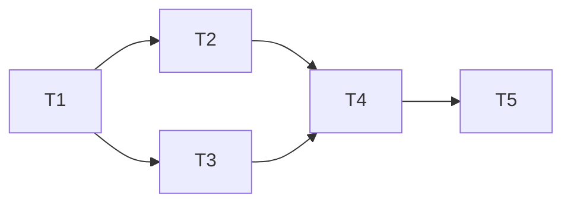

# Week 1 closeout: run eb_jepa Two Rooms and draft the planning protocol

- **Date:** 2026-11-05
- **Status:** In progress
- **Planned by:** planner (Fable 5.1), briefed by the lead session
- **Spec / source:** `docs/roadmap.md`, Week 1 table, last open step; layer E of "The missing toolchain"; the 2026-11-03 product decision that tools target a protocol rather than one model
- **Branch:** `week1-two-rooms-protocol`

## Goal

Finish the one Week 1 step that has not started. Train eb_jepa's action-conditioned Two Rooms world model on a rented RunPod GPU (with the laptop's CPU as the fallback), reproduce its planning success rate, and draft the model-agnostic planning protocol (`encode(obs) → z`, `predict(z, a) → z'`, `energy(z, z_goal)`) as a spec plus a small typed Python module. "Drafted" here means checked against reality: an adapter wraps the trained eb_jepa model in the protocol, a planner written only against the protocol reaches a success rate on the same task that matches eb_jepa's own planner, and a model with untrained weights does not. The numbers go in the spec.

This plan does not build latent-plan. There is no browser UI, no V-JEPA 2-AC adapter, no MPPI beyond what the check needs, no new repository, and no change to jepa-scope's inspector behaviour. Weeks 3 and 4 of jepa-scope follow this milestone and get their own plan.

## Approach

All eb_jepa work happens in a lab directory outside the repository, `~/Workspace/eb_jepa-lab/`, holding a clone of `facebookresearch/eb_jepa` pinned to commit `966e61e`, a Python 3.12 virtual environment with the pinned `torch==2.6.0`, and the checkpoints (`EBJEPA_CKPTS=~/Workspace/eb_jepa-lab/checkpoints`). The scratchpad is not durable (macOS purges it after a few days), so the lab is a normal directory the owner can see. Nothing in it is committed anywhere: no weights, no GIFs, no eval CSVs, no eb_jepa code.

Training runs on a RunPod pod by default, because that is the setting eb_jepa's numbers come from (CUDA, `torch.compile`, bf16) and it costs a few dollars, while CPU training on the laptop is untested, slower and not comparable with the README. The owner has a RunPod account with credit, its SSH keys already include this laptop's, and `runpodctl` is installed. The pod runs the same clone, venv and commands as the lab, under `/workspace/eb_jepa-lab/`; the finished run folder is copied back to `~/Workspace/eb_jepa-lab/checkpoints/` with `scp` (or `runpodctl send`), and the pod is deleted and the deletion confirmed by a fresh read. torch 2.6.0's CUDA builds have no kernels for Blackwell GPUs (RTX 5090, RTX PRO 6000, B200), so those are excluded; the create sets a CUDA floor of 12.4, which current hosts on CUDA 13.x drivers satisfy. The pod needs at least 16 vCPUs, because the data loader generates every trajectory on the CPU with 16 workers.

eb_jepa's `pyproject.toml` requires Python `==3.12.*` (Homebrew has 3.12.15) and declares `decord`, which has no macOS arm64 wheel but is imported by no file in the repository. The install therefore uses `uv pip install -e <clone> --no-deps` followed by an explicit list of what the Two Rooms example actually imports. Device selection is hard-coded to CUDA-or-CPU in three places (`examples/ac_video_jepa/main.py` and the CEM and MPPI planners in `eb_jepa/planning.py`), so the first runs are on CPU; an MPS variant is tried only if CPU is too slow, as a three-line edit in the lab clone that the reproduction notes describe and that is never committed. Training runs with wandb logging off (no account needed; `wandb` must still be importable because `main.py` imports it at module level) and with the in-training planning evaluation switched off, since each evaluation is 20 episodes of planning. The planning evaluation runs once at the end with `--meta.eval_only_mode True`, using eb_jepa's CEM configuration so the later protocol check compares like with like.

Three rules apply to every eb_jepa command in this plan. First, boolean overrides are written `True` or `False` with a capital letter: `main.py` passes arguments through `fire.Fire` and merges them with `OmegaConf.merge` into an untyped config, so a lowercase `false` arrives as the string `"false"`, which Python treats as true, and wandb, the in-training planning evaluation and AMP would all stay on. `WANDB_DISABLED=true` is also exported as a backstop. Second, every command runs from the clone root, `~/Workspace/eb_jepa-lab/eb_jepa`, because `examples` is not an installed package and `--fname` defaults to a relative path; `EBJEPA_CKPTS=~/Workspace/eb_jepa-lab/checkpoints` is exported first. Third, any config file that lives in the lab rather than in the clone is passed by absolute path. On a RunPod pod the lab is `/workspace/eb_jepa-lab/` instead of `~/Workspace/eb_jepa-lab/`, and the exports must be repeated in every SSH shell.

In jepa-scope, the draft lives in a new subpackage `src/jepa_scope/planning/` (`protocol.py` with the `WorldModel` protocol and the `rollout` and `plan_cost` helpers, `cem.py` with a reference CEM planner, `eb_jepa_two_rooms.py` with the adapter behind a lazy import) and a spec at `docs/planning-protocol.md`. The subpackage depends only on torch. The spec is the document other people and the later latent-plan project write adapters against; it records the shapes, the cost definition, the reproduction steps, the measured numbers and the open points. Tests split the way `tests/test_real_model.py` does: `tests/test_planning_protocol.py` runs in CI on a toy point-mass world model and needs nothing but torch; `tests/test_eb_jepa_two_rooms.py` skips unless `JEPA_SCOPE_TWO_ROOMS_CHECKPOINT` points at a trained run, and is executed from the lab venv, into which jepa-scope is installed with `--no-deps` (the planning subpackage imports only torch, and running it on torch 2.6.0 is the lower-risk direction; the reverse, eb_jepa on torch 2.15, is not attempted).

The adapter is where the protocol meets the model. `encode` normalises a `[B, 2, 65, 65]` observation with eb_jepa's `Normalizer.normalize_state`, runs `ImpalaEncoder` on it as a one-frame clip and flattens `[B, 512, 1, 1, 1]` to `[B, 512]`. `predict` calls `RNNPredictor(z.view(B, 512, 1, 1, 1), a.unsqueeze(-1))` and flattens again, which is exactly one step of `JEPA.unroll` in autoregressive mode (the GRU hidden state is the latent). `energy` is the mean squared difference over the 512 dimensions, which is `ReprTargetDistMPCObjective` with H = W = 1. (eb_jepa's README writes this cost with an L2 norm, but the code takes an MSE mean, `planning.py:495-496`; the protocol follows the code and the spec says so.) Strictly, the latent is the GRU output after the shared LayerNorm, which is then fed back as the hidden state; the spec says this rather than "the hidden state is the latent". The model is rebuilt from the run's saved `config.yaml` the way `main.py:174-218` builds it, keeping `final_ln=encoder.final_ln` for the predictor (it shares the encoder's LayerNorm, and `None` crashes at `architectures.py:452`). The checkpoint is read with `torch.load(..., weights_only=True, map_location=device)` (it was saved on a CUDA machine), because the adapter ships in a public wheel and eb_jepa's own loader uses `weights_only=False`; only `model_state_dict` is used, the `regularizer.*` keys and any `_orig_mod.` prefix that `torch.compile` adds on CUDA are dropped, and the rest is loaded with `strict=True` into a module holding the encoder and predictor, so a wrong key mapping fails loudly instead of leaving weights random. If `weights_only=True` refuses the file (the checkpoint also holds optimizer, scheduler and probe states), the named globals are allowlisted with `torch.serialization.add_safe_globals` when they are plain library types; otherwise T4 escalates. The adapter never falls back to `weights_only=False`. The adapter imports only `eb_jepa.architectures`, `eb_jepa.jepa` and `eb_jepa.datasets.two_rooms`, never `eb_jepa.planning`, whose plotting imports (cv2, imageio, seaborn, matplotlib, pandas) it does not need.

The shared contract in this plan is between `protocol.py`, the spec, the toy test and the adapter: a change to the protocol's signatures changes all four together.

## Alternatives considered

- **Create the latent-plan repository now and draft the protocol there.** Rejected for now. The 2026-11-03 decision keeps the order of the other two tools a proposal until one is planned, a repository holding one draft file is a weaker home than a package with tests and CI, and creating it is owner-only. The spec says the subpackage moves to latent-plan when that project is planned. This is an owner question (below), not an assumption.
- **Keep the draft out of the package, under `experiments/`.** Rejected because it would need its own lint, test and import wiring, and the subpackage is tiny and torch-only. If the owner prefers the wheel not to carry a draft API, the tasks below move the three files to `experiments/two_rooms/` and add that path to the lint commands; nothing else changes.
- **Write the spec from the paper and the code without training.** Rejected. "A signal that runs is not a signal that works" applies to a protocol as much as to an energy; without a trained model there is no way to know the adapter is right, and the roadmap wants the protocol drafted against a real world model.
- **Pick the fixed-wall task because it is easier.** Rejected. Training cost is the same (the data size does not change), the README's reference numbers are for the random wall, and the random wall is what the README calls the final setup. The fixed wall remains a fallback if the random-wall run fails its threshold.
- **Train on the laptop's CPU overnight.** Rejected as the default now that a RunPod account is available. It is free but untested for this example, needs AMP and loader settings eb_jepa never measured, and gives a result less comparable with the README. It remains the fallback.
- **Patch eb_jepa for MPS by default.** Rejected as the first move: bf16 autocast and `GradScaler` on MPS are not verified for torch 2.6.0, and the planner is latency-bound where MPS launch overhead can lose to CPU. Measure CPU first; try MPS only for training if CPU training is over the threshold.

## Risks and open questions

- **Running external code on the laptop needs the owner's approval (question).** Installing and running eb_jepa's code was not pre-approved, and the planning session's safety check stopped it. Approving this plan is the approval for running eb_jepa in the lab directory on the laptop (T1, T4 and the fallback) and on RunPod pods (T2), with RunPod spend up to $25 in total. A pod is also the lower-risk place to run outside code, since it is a disposable machine. Say so explicitly when approving.
- **Where the draft lives (question).** Recommendation: `src/jepa_scope/planning/` as above, with a decision line recording that it moves to latent-plan later. Alternative: `experiments/two_rooms/`. The owner picks at approval. This is more than a file location: the subpackage puts a draft public API, and a first piece of latent-plan, into jepa-scope's published wheel. The spec and the module docstring mark it as a draft that may change without notice.
- **Compute cost.** The configs are tuned for an H100 (batch 384, 12 epochs, 100k trajectories per epoch, so 260 steps per epoch and 3,120 steps in all), and the README says training takes up to a few hours on one GPU. RunPod's catalog on 2026-11-05 listed community-cloud prices per hour of $0.79 for an L40S (48 GB, 16 vCPUs minimum), $1.39 for an A100 SXM 80 GB, $1.99 for an H100 PCIe and $2.69 for an H100 SXM, all with low stock. The default is an L40S, falling back to an A100 or an H100 PCIe if it is out of stock; a loader-bound run needs a host with more vCPUs, not a bigger GPU. Expected spend is about $3 to $10 for training and evaluation. **Budget:** the owner allowed RunPod or another cloud GPU "as needed if the required expenditure isn't too crazy"; this plan's cap is $25 in total, which covers a retry and the MPPI evaluation (T4, including its contingency, runs on the laptop and costs nothing). Within the cap, each pod create needs no separate approval, but its GPU type and hourly price from a live catalog read go in the log before the create. Anything that would pass the cap stops for the owner. The laptop path (CPU overnight if T1 projects at most 10 hours) is the fallback only when no suitable GPU is in stock.
- **A single run may land below the README's numbers.** The README's 97 ± 2 % (MPPI) and 96 ± 2 % (CEM) average three seeds and three checkpoints. One seed and one checkpoint can be lower. T2 escalates below 80 %; between 80 and 90 the run is accepted and the spread is noted in the spec.
- **Twenty episodes are a small sample.** A rate measured on 20 episodes carries about ±7 points of sampling error, and two independent 20-episode runs of equally good planners differ by more than 10 points about a third of the time at an 80 % rate. T4 therefore does not compare two independent rates. eb_jepa's evaluation episodes are deterministic (`DotWall` seeds its generator with 0, `env.py:52`, and `main_eval` calls `reset()` once before its loop, `planning.py:177-178`), so T4 replays the same 20 episodes and compares the two planners episode by episode, with the acceptance rule fixed before anything runs. Stepping the environment does not draw from that generator (wall-bump noise uses the global torch generator), so the replay stays aligned whatever the planner does. The two planners' trajectories still differ through sampling noise, so the rule tests the direction of disagreement (does the protocol lose episodes the native planner wins more often than the reverse?), not its total, which mostly measures noise and would fail a correct adapter most of the time at an 80 % rate.
- **MPS unknowns if it is needed.** `torch.compile` is already skipped off CUDA. bf16 autocast, `GradScaler("mps")` and GRU kernels on MPS are unverified for torch 2.6.0; the MPS attempt in T1 runs with `--training.use_amp False` and stops at the first error rather than debugging it.
- **The protocol's single-step `predict` fits an RNN but not a context-window predictor.** V-JEPA 2-AC's predictor needs a history of latents. The draft keeps `predict(z, a)` and records the extension (a context of K latents, or an opaque planner state) as an open point to settle when that adapter is written. This is deliberate scope, not an oversight.
- **Torch version skew in the check.** jepa-scope's planning module runs on torch 2.6.0 in the lab venv. It uses only basic tensor ops; if any call fails there, the module is simplified rather than the pin changed.
- **The milestone order itself is a decision.** The owner chose "milestones follow the roadmap's weekly order, so the remaining Week 1 step comes before Weeks 3 and 4". A later session could re-ask it, so it meets the bar: one line under Process in `docs/decisions.md` and an entry in `docs/decisions/process.md`, written in T5. The roadmap's "Next" section is updated at the same time.

## Dependency summary

- **Parallel group A:** T2 (training, wall-clock bound, external process) and T3 (protocol draft, in the repository).
- **Integration order:** T1, then T2 beside T3, then T4, then T5.

## Task graph

### T1 — Set up the lab, measure the laptop, and pick the RunPod GPU

- **Status:** Done
- **Dependencies:** None
- **Parallel group:** Sequential
- **Complexity:** ROUTINE
- **Execution:** Lead session
- **Owner time:** None
- **Expected files/workspaces:** `~/Workspace/eb_jepa-lab/` (clone, `.venv`, `checkpoints/`, `cfgs/`); `docs/plans/2026-11-05-week1-two-rooms-protocol-log.md`
- **Objective:** Clone eb_jepa at `966e61e` into `~/Workspace/eb_jepa-lab/eb_jepa`, create a Python 3.12 venv at `~/Workspace/eb_jepa-lab/.venv`, install `torch==2.6.0` and the imports the Two Rooms example needs (`torchvision einops fire omegaconf pyyaml tqdm gymnasium scikit-learn pandas matplotlib seaborn opencv-python imageio wandb pytest av`, then `uv pip install -e . --no-deps` on the clone; add whatever `python -c "import examples.ac_video_jepa.main"` still reports missing). PyAV (`av`) is there because jepa-scope's `tests/conftest.py` imports it, and T4 runs pytest from this venv. Write `~/Workspace/eb_jepa-lab/cfgs/eval_2.yaml` (a copy of `examples/ac_video_jepa/cfgs/eval.yaml` with `num_eval_episodes: 2`). Then, from the clone root with `EBJEPA_CKPTS` and `WANDB_DISABLED=true` exported, time a 30-step training run on CPU with no code edits: `python -m examples.ac_video_jepa.main --logging.log_wandb False --meta.enable_plan_eval False --data.num_workers 8 --data.size 11520 --optim.epochs 1` (11,520 = 30 × 384 and the loader drops the last partial batch, so one epoch is 30 steps and a checkpoint is saved). Run it a second time with `--training.use_amp False`, because bf16 autocast on an Apple CPU may be slower than float32. Time planning with those untrained weights, since planning cost does not depend on the weights: `python -m examples.ac_video_jepa.main --meta.model_folder <that run folder> --meta.eval_only_mode True --meta.enable_plan_eval True --eval.eval_cfg_path ~/Workspace/eb_jepa-lab/cfgs/eval_2.yaml --eval.plan_cfg_path examples/ac_video_jepa/cfgs/planning_cem.yaml --logging.log_wandb False`. Try `num_workers` 4 and 8 if the first run looks loader-bound (the data is generated per trajectory in `__getitem__`). The laptop timings serve T4, which plans on this CPU, and the fallback; if T4's projected episodes are long, they run unattended overnight on the laptop. Only if the laptop becomes the training path and the CPU projection exceeds 10 hours, apply the three-line MPS edit in the lab clone (`main.py` line 95 and `planning.py` lines 560 and 683, `"mps"` when `torch.backends.mps.is_available()`), rerun the training timing with `--training.use_amp False`, and revert the edit if it fails. With wandb off, `main.py` logs no per-step times, so step time comes from tqdm's rate over the last 20 steps (or the wall clock of the whole run divided by 30), and episode time from `avg_episode_time` in the eval CSV. Record the chip and memory (`sysctl -n machdep.cpu.brand_string hw.memsize`), seconds per step with AMP on and off, seconds per planning episode, the projections for 3,120 training steps, for the T2 evaluations (20 CEM episodes, plus 20 MPPI if run) for T4's episodes (20 protocol, 20 greedy at negligible cost, 10 untrained), and for T4's contingency (50 native CEM plus 50 protocol episodes on the laptop), and the recommendation. Note that eb_jepa's planner re-encodes the start observation for every sample, so its episode time is not comparable with the protocol planner's and is not used in any comparison.
- **Success criteria:**
  - The example imports and runs 30 steps on CPU and writes `latest.pth.tar`. The log has no "Planning eval:" line, and the run completing at all shows `log_wandb` was read as false (a truthy value calls `wandb.log` without an init at step 0, `main.py:387`; the "W&B logging disabled" line comes from `WANDB_DISABLED` and proves nothing about the override). The AMP-off run logs "AMP disabled" (`main.py:125`).
  - The log has measured seconds per training step and per planning episode, the projections for T4 and for the laptop fallback, and the GPU type picked for T2 from a live RunPod catalog read with its hourly price and projected total.
- **Verification:**
  - `ls ~/Workspace/eb_jepa-lab/checkpoints/ac_video_jepa/*/*/latest.pth.tar`
  - The log entry with the numbers.
- **Escalate if:**
  - torch 2.6.0 or any required package has no macOS arm64 wheel for Python 3.12, or the example fails to import after the explicit install.
  - The projected RunPod total would pass the $25 cap: stop and ask the owner.

### T2 — Train the random-wall model on a RunPod pod and reproduce eb_jepa's planning success rate

- **Status:** In progress
- **Dependencies:** T1
- **Parallel group:** A
- **Complexity:** ROUTINE
- **Execution:** Lead session, on one RunPod pod driven with `runpodctl` and SSH from the laptop. The laptop fallback (only when no suitable GPU is in stock) runs the training and evaluation commands below in the lab instead, with T1's loader and AMP settings.
- **Owner time:** None, unless the cap would be passed
- **Expected files/workspaces:** on the pod, `/workspace/eb_jepa-lab/` (clone, venv, checkpoints, logs); on the laptop, `~/Workspace/eb_jepa-lab/checkpoints/ac_video_jepa/<run>/` (weights, `config.yaml`, `config.train.yaml`, `plan_eval/`, `unroll_eval/`, `train.log`, `eval_cem.log`); the plan log
- **Objective:** Follow these steps in order.
  1. **Pick the image and GPU from live reads.** List official images with `runpodctl template list --type official` and pick a `runpod/pytorch` image built on CUDA 12.4 (its tag names `cuda12.4` or `cu124`; the image's own torch is not used). Official images run sshd and include gcc and `runpodctl`. Read the catalog (`runpodctl gpu list`, or the RunPod `list-gpu-types` tool with availability) and pick the cheapest in-stock non-Blackwell GPU from L40S, A100 80 GB and H100 PCIe whose hosts offer at least 16 vCPUs. Write the image tag, GPU, tier, hourly price, projected hours and the running total against the $25 cap into the log before creating anything.
  2. **Create the pod.** `runpodctl pod create --name jepa-scope-two-rooms --image <tag> --gpu-id "<gpu id>" --cloud-type COMMUNITY --public-ip --min-cuda-version 12.4 --container-disk-in-gb 20 --volume-in-gb 40 --volume-mount-path /workspace --ports 22/tcp --wait --wait-timeout 30m` (use the image's CUDA version as the floor if it is higher than 12.4; use SECURE instead of COMMUNITY only if no community host is in stock, and log its price). The volume keeps the lab across a pod restart; the container disk does not. Record the pod id. If the create returns any error that carries a pod id (for example a `--wait` timeout while a large image pulls), the pod exists and is billing: record the id, start both watchdogs and read the pod back before doing anything else, and never create a second pod in its place. Read the pod back and confirm GPU, image, ports, the vCPU count and the billed `costPerHr`, which is the price the log uses. `runpodctl pod create` has no vCPU filter, so a pod with fewer than 16 vCPUs is deleted and re-picked; to require more vCPUs, create with the RunPod `create-pod` tool and its `gpu.minVcpuCountPerGpu` field instead.
  3. **Start two spending watchdogs at once.** The primary one runs on the pod, so it works even if the laptop sleeps or the lead session ends. RunPod gives every pod a pod-scoped `RUNPOD_API_KEY` and `RUNPOD_POD_ID` in PID 1's environment (not in SSH shells), so over SSH run `export $(tr '\0' '\n' </proc/1/environ | grep '^RUNPOD_' | xargs)` and then `nohup sh -c "sleep <2 × projected seconds>; runpodctl pod stop \$RUNPOD_POD_ID" > /workspace/eb_jepa-lab/watchdog.log 2>&1 &`. The second runs on the laptop as a backstop: `nohup caffeinate -i sh -c 'sleep <2 × projected seconds + 1800>; runpodctl pod stop <pod id>' > ~/Workspace/eb_jepa-lab/watchdog-<pod id>.log 2>&1 &`. Log both PIDs. A stop frees the GPU and keeps the 40 GB volume (whose storage costs about a cent an hour), so the run survives. Restart the on-pod watchdog with a new limit whenever the projection changes, and kill the laptop one after the pod is deleted.
  4. **Set up over direct SSH.** RunPod's proxied SSH does not carry `scp`, so use the direct endpoint from `runpodctl ssh info <pod id>` (`ssh root@<ip> -p <port>`, and `scp -P <port>` later). On the pod, install tmux (`apt-get update && apt-get install -y tmux`) and uv, then create the venv with uv's own Python, which ships the headers Triton needs to compile its launcher. uv keeps its Pythons and cache under the home directory, which is on the container disk and is wiped by a restart, so put them on the volume first: `export UV_PYTHON_INSTALL_DIR=/workspace/eb_jepa-lab/python UV_CACHE_DIR=/workspace/eb_jepa-lab/.uv-cache`, then `uv venv --python 3.12 --python-preference only-managed /workspace/eb_jepa-lab/.venv`. Clone eb_jepa at `966e61e` into `/workspace/eb_jepa-lab/eb_jepa` and install as in T1, with `torch==2.6.0` and `torchvision==0.21.0` in the same command so the resolver cannot pull a newer torch. Environment variables set at create time do not reach SSH shells, so every command below starts with `export EBJEPA_CKPTS=/workspace/eb_jepa-lab/checkpoints WANDB_DISABLED=true UV_PYTHON_INSTALL_DIR=/workspace/eb_jepa-lab/python UV_CACHE_DIR=/workspace/eb_jepa-lab/.uv-cache` and runs from the clone root. After a restart, reinstall tmux and uv (both on the container disk); the venv and its Python survive on the volume.
  5. **Smoke-test the CUDA path.** Run T1's 30-step command on the pod, but with the README's loader and precision (`--data.num_workers 16`, AMP and `torch.compile` left on as `train.yaml` sets them): `python -m examples.ac_video_jepa.main --logging.log_wandb False --meta.enable_plan_eval False --data.size 11520 --optim.epochs 1`. The log must show "Using device: cuda" and "Compiling model with torch.compile". This turns the GPU projection into a measurement: update the log's projected hours, the running total and, if the projection grew, the watchdog. If compile fails, retry once; if it fails again, run with `--model.compile False` and log it as a deviation. If `nvidia-smi` shows the GPU mostly idle, the loader is CPU-bound; the fix is a host with more vCPUs (24 or 32), not a bigger GPU. If the GPU runs out of memory, move to an 80 GB card rather than change the batch size.
  6. **Train.** In a `tmux` session (which survives an SSH disconnect), run the full training with the README's best configuration, unchanged except for logging and the in-training evaluation: `python -m examples.ac_video_jepa.main --logging.log_wandb False --meta.enable_plan_eval False --meta.seed 1 2>&1 | tee -a /workspace/eb_jepa-lab/train.log` (`-a`, so a resumed run appends rather than overwriting the log). Check in from the laptop about once an hour. Training has finished when `e-11.pth.tar` exists in the run folder, the Python process has exited and the log's last line is the end of epoch 11. If the pod restarts or the process dies, resume with the same command plus `--meta.model_folder <run>`, which reloads `latest.pth.tar` (`main.py:249-258`); a restart counts as one strike, and its cost counts against the cap.
  7. **Evaluate on the pod.** Copy `<run>/config.yaml` to `<run>/config.train.yaml`, because an eval-only run rewrites `config.yaml` with the eval-time config (`main.py:159-161`). Then run the CEM evaluation on 20 episodes and keep its output: `python -m examples.ac_video_jepa.main --meta.model_folder <run> --meta.eval_only_mode True --meta.enable_plan_eval True --eval.plan_cfg_path examples/ac_video_jepa/cfgs/planning_cem.yaml --logging.log_wandb False 2>&1 | tee <run>/eval_cem.log`. Check that the log contains "Loaded model state from": a mistyped folder is created silently and evaluated with random weights (`main.py:86`, `training_utils.py:195-197`). If the cap allows, run the MPPI evaluation too (`planning_mppi.yaml`, logging to `<run>/eval_mppi.log`), since that is the README's headline number; first rename `plan_eval/step-*_eval_only/` to `..._cem`, because both evaluations write to the same folder and `eval.csv` is appended to.
  8. **Copy back and tear down.** Move `/workspace/eb_jepa-lab/train.log` into the run folder, then copy the run folder to the laptop with `scp -r -P <port>` (an estimated 0.3 to 0.6 GB). Check that the laptop copy has `latest.pth.tar`, all twelve `e-N.pth.tar` files and both logs. Delete the pod with `runpodctl pod delete <pod id>`, confirm with a fresh read that its id is absent from the RunPod `list-pods` tool, kill the watchdog, and log the pod's uptime, billed cost and the running total (the RunPod `list-pod-billing` tool; billing can lag by up to an hour, so until it catches up, log uptime × the billed `costPerHr`).
  9. **Record.** Log `success_rate`, `mean_state_dist` and `avg_episode_time` from `plan_eval/step-*_eval_only*/eval.csv`, the unroll MSE from `unroll_eval/step-*_eval_only/eval.csv`, the per-episode outcomes (from the "GIF saved to …/ep_k/agent_steps_succ|fail.gif" lines of `eval_cem.log`, which are also the GIF file names), the run folder, the GPU, the wall-clock time and the seed.
- **Success criteria:**
  - The CEM evaluation on 20 random-wall episodes reports a success rate of at least 80 %.
  - The laptop copy of the run folder has `config.train.yaml`, `latest.pth.tar`, the twelve `e-N.pth.tar` files, `train.log` and `eval_cem.log`, and nothing from it is in the repository.
  - None of the pod ids this plan created remain in `list-pods`, and the total RunPod spend is within the $25 cap. Pods this plan did not create are never touched.
- **Verification:**
  - `cat <run>/plan_eval/step-*_eval_only*/eval.csv <run>/unroll_eval/step-*_eval_only/eval.csv`
  - The pod ids this plan created are absent from the RunPod `list-pods` tool; the log has each pod's cost and the running total.
  - `git -C ~/Workspace/jepa-scope status --short` shows no lab files.
- **Escalate if:**
  - Success is below 80 %: report the loss curves from the log and the unroll MSE, and propose one of: a second seed or the fixed-wall task, within the cap. Do not tune hyperparameters.
  - Training stops with an error that one retry does not clear (two strikes), or the pod is lost twice.
  - Any step would take the running total past $25.

### T3 — Draft the protocol: spec, typed module, reference CEM and a CI test on a toy world model

- **Status:** Done
- **Dependencies:** T1 (so the draft is written knowing the run exists and the adapter target is fixed)
- **Parallel group:** A
- **Complexity:** STRONG
- **Execution:** Executor (Opus) on the branch, or the lead if it is idle while training runs
- **Owner time:** None until review
- **Expected files/workspaces:** `src/jepa_scope/planning/__init__.py`, `src/jepa_scope/planning/protocol.py`, `src/jepa_scope/planning/cem.py`, `docs/planning-protocol.md`, `tests/test_planning_protocol.py`, `.gitignore` (add `*.pth.tar` and `*.gif` as a backstop)
- **Objective:** Write the protocol as `typing.Protocol` classes and free functions, torch-only, with full docstrings. `WorldModel` has `latent_shape: tuple[int, ...]`, `action_dim: int`, `encode(obs: Tensor[B, *obs]) -> Tensor[B, *latent]`, `predict(z: Tensor[B, *latent], a: Tensor[B, action_dim]) -> Tensor[B, *latent]` (one step, stateless) and `energy(z: Tensor[B, *latent], z_goal: Tensor[B, *latent]) -> Tensor[B]` (non-negative, lower is better, unitless and comparable only within one model). `rollout(model, z0, actions: Tensor[B, T, A]) -> Tensor[B, T + 1, *latent]` includes `z0` at index 0. `plan_cost(model, z0, actions, z_goal) -> Tensor[B]` sums `energy` over all T + 1 latents including index 0; that is eb_jepa's `sum_all_diffs` objective and the spec says why the sum beats the last-step cost (the README's "MPPI last" ablation). `cem.py` implements the Cross-Entropy Method against the protocol only: Gaussian proposal over `[T, A]`, `num_samples`, `num_elites`, `n_iters`, an initial std (`var_scale`), an optional per-step action norm clip (`max_norm`), a `torch.Generator` for determinism, and a result holding the mean action sequence and the per-iteration best cost. Mirror eb_jepa's `CEMPlanner` semantics exactly so T4 can compare: the `planning_cem.yaml` numbers (plan length 90, 20 iterations, 200 samples, 20 elites, std 1.5, norm clip 2.45, re-plan every step and execute one action); the horizon is `min(plan_length, steps_left)`, so it shrinks over the last 90 steps (`planning.py:572-575`); the mean restarts at zero on every re-plan, with no warm start (`planning.py:578`); samples are norm-rescaled before they are scored (`planning.py:607-618`); the new mean and std are the mean and unbiased std of the elites (`planning.py:635-636`); the returned plan is the elite mean, not the best sample (`planning.py:651`). `max_norm_dims` is ignored by eb_jepa and is not reproduced. The spec `docs/planning-protocol.md` has: purpose and the roadmap pointer; the three operations with shapes and invariants; `rollout` and `plan_cost`; the reference CEM; an "Adapters" section listing the eb_jepa Two Rooms adapter (filled in by T4); a "Checked against" section with the reproduction steps, the measured numbers and their roughly ±7-point sampling error, and the note that success is measured after the last allowed step rather than on first arrival (filled in by T2 and T4); and "Open points": context-window predictors (V-JEPA 2-AC), stochastic predictors, energy calibration across models (jepa-scope's surprise floor is the precedent), goal batching, and action-space specs. The CI test defines a point-mass model (obs = z ∈ R², `predict` adds the action clipped to a max norm, `energy` is the squared distance) and checks that CEM from the origin reaches a goal at (5, 5) within 0.5 units in 12 steps, that `plan_cost` of the planned sequence is below that of random actions, and that two runs with the same generator seed give the same actions. It must finish in under 5 seconds on CPU.
- **Success criteria:**
  - `uv run pytest -q tests/test_planning_protocol.py` passes; the full suite and lint pass.
  - `docs/planning-protocol.md` is readable by someone who has never opened eb_jepa and tells them what to implement to add a model.
  - The shapes in the spec, the module and the test agree.
- **Verification:**
  - `uv run ruff check src tests && uv run ruff format --check src tests && uv run pytest -q`
  - `python3 .claude/workflow/check.py`
- **Escalate if:**
  - The design needs a second operation beyond the three (for example a separate history argument) to make CEM work on the toy or on the eb_jepa shapes: stop and bring the question to the lead rather than widening the protocol silently.

### T4 — Wrap the trained model in the protocol and check parity and planning success through it

- **Status:** Pending
- **Dependencies:** T2, T3
- **Parallel group:** Sequential
- **Complexity:** STRONG
- **Execution:** Lead session or Executor (Opus); the opt-in test runs from the lab venv on the owner's machine
- **Owner time:** None
- **Expected files/workspaces:** `src/jepa_scope/planning/eb_jepa_two_rooms.py`, `tests/test_eb_jepa_two_rooms.py`, `docs/planning-protocol.md` (the Adapters and Checked-against sections)
- **Objective:** Implement `EbJepaTwoRooms` as described in the approach, with `from_run(folder: Path, device="cpu")` reading `config.yaml` and `latest.pth.tar` (or a named `e-N.pth.tar`), importing eb_jepa lazily and raising a clear `ImportError` naming the lab setup if it is absent. Install jepa-scope into the lab venv with `uv pip install -e ~/Workspace/jepa-scope --no-deps`. Write `tests/test_eb_jepa_two_rooms.py`, skipped unless `JEPA_SCOPE_TWO_ROOMS_CHECKPOINT` is set, with four tests.

  - **Parity.** The reference is independent of the adapter: a full `JEPA(encoder, nn.Identity(), predictor, regularizer, SquareLossSeq())` constructed exactly as `main.py:174-218` does and loaded with eb_jepa's own `load_checkpoint(..., strict=True)`. (The adapter's encoder-and-predictor module cannot serve, because `unroll` is defined on `JEPA`, not `JEPAbase`, and comparing the adapter with its own modules proves nothing.) On a batch of 8 observations from `DotWall` and random actions `[8, 8, 2]`, `rollout(adapter, adapter.encode(obs), actions)[:, 1:]` must match `ref.unroll(obs5d, actions.permute(0, 2, 1), nsteps=8, unroll_mode="autoregressive", compute_loss=False)[0][:, :, 1:].flatten(3).squeeze(-1).permute(0, 2, 1)` to a max absolute difference under 1e-5, in float32 on CPU in eval mode. The permute matters: `unroll` returns `[B, 512, 9, 1, 1]` and `rollout` returns `[B, 9, 512]`, and comparing them without it compares values in a different order. `plan_cost` must match eb_jepa's real `ReprTargetDistMPCObjective(target_enc, sum_all_diffs=True)`, imported from `eb_jepa.planning` in the test (the lab venv has its plotting dependencies; the adapter itself still never imports it).
  - **Paired success.** Build the environment exactly as `main.py:139-153` does, not from the dataclass defaults (which have `fix_wall=True`, `img_size=64` and `device="cuda"`; the fixed-wall branch also skips a generator draw, so every later episode would shift without any error): `env_config = init_data("two_rooms", cfg_data=<eval.yaml>["data"])[2]` and `env = DotWall(config=env_config, **<eval.yaml>["env"])` with the default generator. Call `reset()` once before the loop, as `main_eval` does (`planning.py:177-178`), so the 20 episodes are the same (wall, start, goal) tuples eb_jepa's own evaluation used in T2. Log each replayed episode's wall, start and goal, and check the replay against T2 by comparing the replayed initial and goal frames of episodes 0 and 1 with T2's `ep_0/state.pdf` and `ep_1/state.pdf` (or the first GIF frame). Run each episode the way `main_eval` does: the zero-action first step (`planning.py:211-214`), re-planning every step with the reference CEM and the `planning_cem.yaml` numbers, all 200 steps with no early stop on `done`, and success judged by `env.eval_state` (distance under 4.5) after the last step (`planning.py:249-296`). Print a per-episode table beside T2's native outcomes (read from the "GIF saved to …/ep_k/agent_steps_succ|fail.gif" lines of T2's log) and count native-only and protocol-only successes.
  - **Greedy baseline.** The same 20 episodes with a policy that steps straight toward the goal's true position at norm 2.45. Start and goal are always in opposite rooms at this level, so this succeeds only when the door is roughly on the line; it measures how much the task needs planning. (Doing nothing scores 0 % by construction and would carry no information.)
  - **Untrained control.** The same loop on an adapter built from the run's config with freshly initialised weights (seed 0), capped at 10 episodes for time.

  Then fill the spec's Adapters section (how the three operations map onto eb_jepa, including the post-LayerNorm latent fed back as the GRU state, the shared LayerNorm and the normaliser) and Checked-against section (the T2 native numbers, the parity result, the paired table, the baseline and the control, the machine and wall-clock times, and the exact commands).
- **Success criteria (fixed before anything runs; never tuned afterwards):**
  - Parity holds under 1e-5.
  - On the 20 paired episodes, the protocol planner succeeds on at least 70 %, and native-only successes minus protocol-only successes is at most 2. On a marginal 3 or 4, both planners are rerun on 50 episodes from the same generator before any conclusion, and the margin must be at most 4. Under equally good planners those two counts are symmetric however noisy the outcomes are.
  - The untrained adapter scores at most 20 %. The greedy baseline's rate is reported; it is not a pass condition, but a greedy rate within 10 points of the protocol's is an escalation.
  - `uv run pytest -q` in the jepa-scope venv still passes with the new test skipped, and CI does not run it.
- **Verification:**
  - `JEPA_SCOPE_TWO_ROOMS_CHECKPOINT=<run> ~/Workspace/eb_jepa-lab/.venv/bin/python -m pytest tests/test_eb_jepa_two_rooms.py -s`
  - `uv run pytest -q -rs` shows the test as skipped.
- **Escalate if:**
  - Parity holds but the success rate misses the band: the planner or the episode loop differs from eb_jepa's, not the protocol; compare against `main_eval` step by step before changing the protocol.
  - Parity fails: the adapter's `predict` or normalisation is wrong; do not adjust tolerances.
  - The replayed frames of episodes 0 and 1 differ from T2's `state.pdf` images (most likely an environment config that is not the one `main.py` builds): stop and fix the replay before reading any rate, since an unpaired comparison is not evidence.
  - The untrained control scores above 20 %, or the greedy baseline comes within 10 points of the protocol: the task is easier than the README implies and the success criterion is not evidence; report before writing numbers into the spec.
  - `weights_only=True` refuses the checkpoint for a reason an allowlist of plain library types does not fix.
  - The 50-episode contingency projects beyond about 12 hours on the laptop (eb_jepa's native CEM re-encodes the start observation for every sample, so it is slow on a CPU): ask before running it.

### T5 — Close out: roadmap, decisions, plan status, review, owner summary

- **Status:** Pending
- **Dependencies:** T4
- **Parallel group:** Sequential
- **Complexity:** ROUTINE
- **Execution:** Lead session, with `reviewer` (Opus, fresh context) on the diff and this plan
- **Owner time:** 0.5 h to read the spec's numbers and the summary, then merge (owner-only)
- **Expected files/workspaces:** `docs/roadmap.md`, `docs/decisions.md`, `docs/decisions/product.md`, `docs/decisions/method.md`, `docs/decisions/process.md`, `docs/plans/README.md`, this plan and its log
- **Objective:** Mark the Week 1 row "Done" with a one-line pointer to the spec and the measured rate; add a lesson under "What Week 1 taught" only if one emerged (the protocol-versus-native parity check is a candidate: a wrapper that runs is not a wrapper that is right until its outputs are compared to the original's). Replace the roadmap's "Next" list with the owner's order (Weeks 3 and 4 next) and the note that Week 2's scope landed in Week 1. Add decision lines that meet the bar: under Product, where the protocol draft lives and that it moves to latent-plan; under Method, the protocol's shape and cost definition as checked; under Process, that milestones follow the roadmap's weekly order, and that cloud GPU spend within a cap the owner approved in a plan needs no further approval. Update the plan's `Status:` line, remove it from the active list, compress the log into the completion summary, delete the log file, run `/checkpoint`, run the reviewer, fix material findings, and write the owner summary with the numbers, the RunPod spend and the gates taken (plan approval, T3's signatures, the cap if it was reached, and merge).
- **Success criteria:**
  - `python3 .claude/workflow/check.py` passes; CI is green on the PR.
  - The reviewer's verdict is Pass or its material findings are fixed and checks rerun.
- **Verification:**
  - `python3 .claude/workflow/check.py`; the CI run on the pull request.
- **Escalate if:**
  - The reviewer disputes the protocol's shape: resolve with `architect` before the owner reviews; do not merge a contested contract.

## Execution strategy

- **Lead/orchestrator owns:** the lab directory and every run in it, the owner gates, integration, the roadmap and decisions edits.
- **Delegated tasks:** T3 to an executor (Opus) because it is self-contained and runs while the pod trains; T4 to an executor only if the lead's context is large by then, since it needs the lab venv and the owner's machine either way.
- **Model routing:** T1 ROUTINE, T2 ROUTINE, T3 STRONG, T4 STRONG, T5 ROUTINE with the reviewer at its default (Opus, high).
- **Owner time, total:** about 45 minutes of attention (approval 0.25 h, review and merge 0.5 h). RunPod spend is capped at $25.
- **Approval gates:**
  - Owner approves this plan, which also approves installing and running eb_jepa in the lab directory on the laptop and on RunPod pods, with RunPod spend up to $25 in total.
  - Anything that would pass the $25 cap is a separate owner approval with a quoted price.
  - Owner approves T3's first small change (the protocol module's signatures) before the executor writes the rest, per the milestone rule.
  - Merging is owner-only.
- **Review strategy:** the reviewer runs once at T5 on the whole diff and the plan, with the spec's numbers and the test output in front of it. If T3 lands long before T4, a quick reviewer pass on the protocol module alone is allowed so T4 does not build on a shape that will change.

### Concurrency and isolation

| Task | Actually concurrent with | Worker/session | Writes files? | Branch/base | Isolation | Shared mutable resources | Integration |
|---|---|---|---:|---|---|---|---|
| T1 | None | Lead | Lab only | `main` at `4ab37dd` (read-only in the repo) | External environment | CPU | Report only |
| T2 | T3 | Lead (RunPod pod; laptop fallback) | Lab only | n/a | External environment (RunPod pod) | The pod; laptop CPU on the fallback | Artifact handoff (checkpoint copied to the lab) |
| T3 | T2 | Executor | Yes | `week1-two-rooms-protocol` from `main` | Main checkout, single writer (a worktree if the lead also edits) | None | Direct |
| T4 | None | Lead or Executor | Yes | `week1-two-rooms-protocol` | Main checkout | Lab venv, checkpoint | Direct |
| T5 | None | Lead | Yes | `week1-two-rooms-protocol` | Main checkout | None | PR to `main` |

- **T2 and T3 timing:** Concurrent. Training is wall-clock bound and touches nothing in the repository; T3 is the only writer in the checkout. The lead does not edit repository files while the executor holds the checkout; if that becomes necessary, the executor gets a worktree (`uv sync` there first) and integrates by cherry-pick. T3's inputs are tracked (nothing from the lab is needed). T2's output is a path handed to T4.
- **Single-instance resources:** the RunPod pod belongs to T2 alone, and this plan has at most one pod at a time. On the laptop fallback, the CPU is shared by training and by the executor's test runs, which only slows both, and the Apple GPU is claimed only on the MPS path, during which no jepa-scope embedding runs. No port is used.

## Execution log

Kept in `docs/plans/2026-11-05-week1-two-rooms-protocol-log.md`, in the template's entry format. Material items expected there: the T1 measurements and the GPU picked; for each pod, the image, GPU, tier, hourly price before creation, uptime, billed cost, deletion confirmation and the running total against the $25 cap; the T2 run folder and native numbers, any MPS attempt and its outcome, the T4 parity and success numbers, and any deviation from the planner settings.

## Integration and verification

### Integrated checkpoint

- [ ] `/checkpoint` completed (lint → tests → build → workflow check)
- [ ] Any checkpoint failures resolved and the checkpoint rerun

### End-to-end acceptance

- [ ] eb_jepa's own CEM evaluation on the trained model reports at least 80 % on 20 random-wall episodes, recorded in the spec with the machine and time.
- [ ] The opt-in test passes from the lab venv: parity under 1e-5, the paired rule met, the untrained control at most 20 %, and the greedy baseline more than 10 points below the protocol.
- [ ] CI passes with the opt-in test skipped and the toy test running.
- [ ] `docs/planning-protocol.md` can be followed by a reader without eb_jepa to implement an adapter, and by a reader with the lab to reproduce the numbers.

### Independent review

- **Reviewer:** `reviewer` (Opus, high), fresh context, on the diff plus this plan
- **Verdict:** Pending
- **Findings:** Pending
- [ ] Material findings resolved
- [ ] Relevant verification rerun after fixes

## Completion summary

- **Delivered:** Pending
- **Deviations from approved plan:** Pending
- **Known risks / follow-up:** Pending
- **Decision records updated:** Pending
- **Lesson:** Pending
