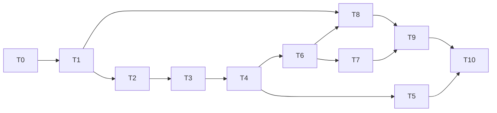

# jepa-scope Weeks 3 and 4: folder indexing, nearest-neighbour search and the latent trajectory view

- **Date:** 2026-11-06
- **Status:** Draft
- **Planned by:** planner (Fable 5.1), briefed by the lead session (Opus 5.5); revised after one
  adversarial review and one outside review (see "Plan review")
- **Spec / source:** `docs/roadmap.md`, "Next" item 1 and the project section's MVP schedule; the
  2026-11-05 process decision that milestones follow the roadmap's weekly order
- **Branch:** `week3-folder-search` (T0–T7), then `week4-trajectory` (T8–T10)

## Goal

Make jepa-scope work on a folder of clips instead of one clip. `jepa-scope <folder>` embeds every
video in the folder once (through the existing result cache), writes one index file, and opens the
viewer with a clip list, "similar moments" and "similar clips" search, and, in Week 4, a 3D view of
the open clip's path through latent space drawn through a cloud of every window in the folder.
Search is brute-force cosine over one vector per window. Which vector and which similarity are
chosen by a small experiment on cached tensors (T0) that runs before any file format is frozen,
with its candidates, decision rule and product-target bars fixed in this plan.

Week 3 (T0–T7) delivers the experiment, then indexing and search end to end, from the `.latent`
change to the viewer panels, with a check that the built code reproduces the experiment. Week 4
(T8–T10) delivers the trajectory view and the closeout. The owner can stop after Week 3 and the
repository is consistent.

This is one plan for both weeks because the roadmap names "Weeks 3 and 4" as one milestone and the
three deliverables share one contract: the folder index and the multi-clip server feed both the
search panels and the trajectory view, and the `.latent` change that the trajectory needs is
cheapest before the owner's folders are indexed, not after.

This plan does not build patch-level ("where in the frame") search, an approximate-nearest-neighbour
library, thumbnails in the result lists, embedding health metrics (Weeks 5 and 6), streaming
embedding for very long clips, or any change to how tokens are computed. Everything runs on the
laptop; no task needs a GPU.

## Approach

**The experiment comes first (T0).** The current `.latent` file already stores, per window, the
mean of all final encoder tokens (`pooled`, float32) and the tokens themselves (`patches`, float16,
kept by default). From those cached tensors T0 computes a predeclared set of candidate
representations ((a) the stored mean of all final tokens with plain cosine, (b) the same centred
on the set's mean, (c) the mean of non-affine re-normalised tokens, and (d) the mean over the
predicted half only), measures class retrieval on Kinetics-mini with fixed baselines and controls,
checks that "similar moments" localises in time, and chooses the default by a rule written in T0
before anything is measured. The result is exploratory (50 clips per set is an anecdote, not a
benchmark) and is confirmed once on a second 50-clip set without re-choosing. T1's descriptor and
T3's defaults take their values from it.

**The `.latent` file goes to format version 2 (T1).** Three things change. `timeline_pooled`,
`float32[G, D]`, is the mean over the H×W patch features of each timeline tubelet, computed from
the encoder tokens as `encode` returns them (float32, upcast from the model's dtype), with the
descriptor's token normalisation applied first, before the float16 cast that `patches` gets (4 KB
per tubelet at ViT-L,
about 160 KB for a 10-second clip, an estimate); it is what the trajectory view plots, and because
the folder indexer embeds without patches by default it is the only per-tubelet vector a folder
clip keeps. The header gains a `representation` block, the canonical description of what the
vectors are, with a hash over it, plus the resolved model revision; the index copies it and refuses
clips whose block differs. And `latent_file.save` becomes a current-format writer that always
stamps the current `format` and `format_version`, whatever the caller's header says.

The format version and `OUTPUT_VERSION` are separate things. The format version says which tensors
and header keys a file has; `OUTPUT_VERSION` says whether the numbers would come out the same. If
T0 keeps the stored mean (candidates (a) or (b)), no number changes and `OUTPUT_VERSION` stays at
2; the cache check reads an old file's header, gets the format-version error, prints that it is
re-embedding, and writes the new file over the same path. If T0 chooses (c) or (d), `pooled` is
computed by the chosen recipe, the descriptor says which, and `OUTPUT_VERSION` goes to 3 as the
2026-11-05 decision requires; that changes the cache file name, so the lead deletes the old files.
Either way every version-1 cache file is invalid after T1, including T0's set, which T5 re-embeds
through the indexer (about 3 minutes for the 50 val clips, an estimate). A version-1 file given
to `jepa-scope view` is refused with a message that says to re-embed it with `jepa-scope embed`.
The plan makes no claim that two jepa-scope versions can share a cache.

**How windows and the timeline relate.** Each 16-frame window has a context half (its first eight
frames, four tubelets) and a predicted half. Windows overlap by half, so the timeline takes window
0 whole and, from every later window `w`, only its predicted half (`timeline_owner` in
`embed.py`); window `w`'s context half appears on the timeline as window `w - 1`'s predicted half,
encoded in a different window. Two consequences shape this plan. The mean of the timeline tubelets
a window owns is not that window's `pooled` vector, so the trajectory view does not claim that a
window's point is the centroid of its tubelets' points. And the window that owns the tubelet at
time `t` is the earlier of the two windows that contain `t`, so a search from time `t` uses the
window whose centre is nearest `t` instead.

**The index is one self-contained safetensors file (T2),** `jepa-scope.index` in the indexed folder
by default, with the same shape of contract as `.latent`: a validated JSON header under the
metadata key `jepa_scope` and a few tensors.

- The header holds `format: "jepa-scope.index"`, `format_version: 1` (`INDEX_FORMAT_VERSION` in a
  new `src/jepa_scope/index_file.py`), the `representation` block copied from the clips (with its
  hash), `run` (`max_seconds`, `device`, `dtype`, the run settings every clip was embedded with),
  `embedding: {kind: "window_vector", similarity: "cosine" | "centred-cosine"}`, `root` (see
  below), `skipped` (files that could not be embedded, with the reason), and `clips`, a list of
  `{path, sha256, size, mtime_ns, duration, width, height, windows: [start, stop)}` with `path`
  relative to `root` using forward slashes.
- The tensors are `pooled float32[N, D]` (every clip's window vectors in clip order),
  `window_start_time float64[N]`, `clip int32[N]`, and `mean float32[D]` (the window-weighted mean
  of `pooled`, stored whether or not centring is on).
- Validation checks exact dtypes; that every value is finite; that the clip ranges are non-empty
  and tile `[0, N)` in order; that `window_start_time` increases strictly within a clip; that
  `clip[r]` agrees with the ranges; and that `hidden_size` matches `D`. An index with no clips
  (an empty folder, or every file skipped) is valid: `N = 0`, `mean` is zeros, and the CLI and
  viewer say that nothing was indexed.
- `root` is `"."` for an index written beside the videos, and it is then resolved as the index
  file's own directory, so the folder can be moved or copied and the index keeps working. An
  index written elsewhere with `--out` records `root` as the absolute folder path; it must be
  given to the commands by its own path, and `--source-root` overrides the recorded path when the
  folder has moved. Only the colocated index is portable with the folder, and the README says so.

For 200 ten-second clips the file is about 7 MB (an estimate). Answering a search never needs the
`.latent` files; viewing a hit does.

**Search is brute force in NumPy (T3),** in `src/jepa_scope/search.py`. Vectors are L2-normalised
once at load, after subtracting the index `mean` when the index says `centred-cosine`; a query is
one matrix–vector product and an `argpartition`. Two query types share that primitive.

- "Moments like this moment" takes one window as the query, the one whose centre is nearest the
  current time (the earlier window on a tie; a time outside the clip's windows is clamped to the
  nearest one). In folder mode the results are windows of other clips, which is what the viewer
  shows by default; a `same_clip=True` option includes non-overlapping windows of the query's own
  clip for the single-clip viewer and for the CLI. Within one clip, a hit that overlaps a
  higher-ranked hit is dropped, so a list of ten hits is ten distinct, non-overlapping moments
  (not necessarily ten distinct events). Because exclusion and suppression remove candidates, the
  search widens its candidate set (2k, 4k, and so on, then a full sort) until it has k hits or
  runs out.
- "Clips like this clip" takes a clip's vector, the mean of its raw window vectors (centred first
  when centring is on), normalised after averaging and never averaged from the normalised rows;
  the results are the other clips.

Plain cosine is the default unless T0 chooses centring. Centring on the folder mean removes a
common direction that can compress raw cosine into a narrow band, but it has failure modes: with
identical clips every centred vector is zero, with two clips the centred clip vectors are
antiparallel, and the window-weighted mean lets long clips dominate. So centring is an explicit,
recorded choice (`jepa-scope index --centre`, stored in `embedding.similarity`), the weighting is
documented, and a vector whose norm is below `1e-6` after centring, or that is not finite, is
"unavailable": it is never a candidate, a query on it returns an empty list with that reason, and
the viewer says so instead of showing a ranking. Equal scores order by `(clip, window)`, so
duplicates rank deterministically.

The numbers that follow are estimates until measured on the owner's laptop in T4. A query over
30,000 windows (about 3,000 ten-second clips, or about 8 hours of video) is a 120 MB matrix and
about 30 ms. Brute force stops being comfortable around half a million windows, which at one
window per second is about 139 hours of video (2 GB resident, about half a second per query). At
that point an approximate-nearest-neighbour library replaces the body of `search.py` behind the
same function signatures, and the index file does not change.

**The indexer (T4)** in `src/jepa_scope/indexing.py` walks the folder (not recursively by default;
`--recursive` opts in and does not follow symlinked directories, so cycles cannot occur) for
`.mp4 .mov .m4v .mkv .webm .avi` and skips anything under `.`-prefixed names. For each video it
finds or makes its `.latent` through the existing cache rule, with the cache path recomputed from
the current settings every time (never read back from the index): it reuses a with-patches cache
file if one exists and is valid, otherwise a without-patches one, otherwise it embeds with
`keep_patches=False` (saving about 4 MB per window; `--patches` keeps them).

- Refresh is incremental. A file whose size and `mtime_ns` match its index entry, and whose
  recomputed cache path exists and passes the cache check (representation hash and output
  version), is kept without re-hashing. Otherwise it is hashed, and a changed hash or a missing or
  invalid cache file means re-embedding. Files that disappeared are dropped. `jepa-scope index
  --verify <folder>` hashes every file regardless of size and mtime, reuses cache files by the
  verified hash, and rewrites the index; it is the repair the server names when it refuses a
  changed file.
- An index whose representation hash, run settings or format version differ from the current run
  is rebuilt from scratch with a printed reason.
- One bad file does not stop the run. A clip shorter than one window, a source below the sampling
  rate, a file with no video stream or a model output with NaN values is reported, skipped, and
  listed under `skipped` in the index header.
- Progress prints per clip. An interrupted run loses only the index file, because every embedded
  clip is already in the cache, so rerunning resumes.
- Embedding dominates the cost, about 0.35 s per second of video on an M3 Max (an estimate from
  the 10-second clip the README times), so an hour of video takes about 20 minutes.
- This milestone supports clips up to about 10 minutes each on a laptop with 32 GB of memory or
  more, and about 5 minutes with 16 GB (estimates). `embed_video` keeps every decoded frame and
  every window's tokens in memory even with `keep_patches=False`, plus the float16 timeline stack
  and the float32 copy the PCA colouring makes, about 8 to 9 GB at the peak for a 10-minute clip
  (an estimate from 8 fps at a 292-pixel short edge and 4 MB of tokens per window). Longer clips
  need `--max-seconds`; streaming embedding is outside this plan and the README states the limit.

T4's CLI gains `jepa-scope index <folder> [--out PATH] [--recursive] [--patches] [--centre]
[--verify] <embed args>` and `jepa-scope search <folder|index> <clip-in-index | query.mp4>
[--at SECONDS] [-k 10] [--by moment|clip] [--same-clip] [--source-root DIR]`. `search` takes no
embedding arguments: a query video not in the index is embedded through the cache with the index's
representation and run settings, and a query that cannot be embedded that way is refused. T6,
which makes the server able to serve a folder, also makes the default command accept a folder
(`jepa-scope <folder>` indexes, refreshing, then serves) and `jepa-scope view` accept a folder, an
index file or a `.latent`, so no merged pull request offers a command that cannot run. Both take
`--source-root` for a relocated external index.

**The server serves many clips (T6).** `create_app` takes an index path, a folder, or a single
`.latent`, which it wraps as a one-clip in-memory index so the viewer sees one shape in both modes.
In folder mode the clip's video path and display name come from the index entry, never from the
cached file's `source.path`, because byte-identical files under two names share one cache file.
Opening a clip checks that the cached file's `source.sha256` equals the index entry's hash, that
its representation hash matches the index, and that its window count and start times match the
index rows. A clip whose cache file is missing or fails those checks is refused on its own, with
the message naming `jepa-scope index <folder>`, while the rest of the folder keeps working. Clip
tensors load lazily on first request with `safe_open`, reading only what the viewer needs (the
timeline tensors, `timeline_pooled` and `window_start_time`, never `patches`), into a cache
bounded by bytes (256 MB, which holds a few hundred ten-second clips, an estimate). The endpoints
are these.

- `GET /api/meta` returns `{mode: "folder"|"single", index: {root, representation, format_version,
  windows: N, embedding}, clips: [{id, name, path, duration, width, height, windows}]}`.
- `GET /api/clips/{id}/meta` returns today's per-clip `{header, timeline}` plus
  `timeline.window: int[]` and `windows.start_time: number[]`.
- `GET /api/clips/{id}/pca` and `/surprise` return bytes in the unchanged layout.
- `GET /api/clips/{id}/video` keeps the existing SHA-256 refusal. The server hashes a clip's video
  on its first open and remembers the result keyed by the file's size, `mtime_ns` and inode; when
  any of those change it hashes again. A mismatch returns 409 with "the file changed since it was
  indexed; run `jepa-scope index --verify <folder>`", and the viewer shows that message. The
  remaining limit, documented in the README, is a replacement made within one server session that
  preserves size, mtime and inode; the next `index --verify` catches it.
- `GET /api/search?clip=&window=&k=[&same_clip=1]` and `GET /api/search?clip=&k=&by=clip` return
  `{hits: [{clip, window, row, start_time, score}]}` or `{hits: [], reason: "unavailable"}`.
  `window` is clip-local (0-based within the clip) everywhere in the API; `row` is the index-wide
  row, `clips[clip].windows[0] + window`. Invalid `k` returns 400, an unknown clip or window 404.
- Week 4 adds `GET /api/clips/{id}/trajectory?fit=folder|clip`, returning `float32[G, 3]` bytes;
  `GET /api/cloud`, returning `float32[M, 3]` bytes for at most 50,000 rows chosen by a seeded
  subsample, with the chosen rows listed in `/api/meta`; and `GET /api/cloud/points?rows=1,2,3`,
  returning `float32[len, 3]` for the named rows in the folder fit, so a search hit always has a
  position whether or not it was sampled. Each of these carries a `projection_id` header
  (`folder:<the SHA-256 of the index file>` or `clip:<id>`), and the viewer draws together only
  objects that share
  one.

The folder fit is a 3-component PCA (`pca.fit`, which pins signs) on the index's `pooled`, capped
at 50,000 sampled rows independently of the display cap. `timeline_pooled` is projected with the
same mean and components, so every clip and the cloud share one set of axes. A window's cloud
point is not the centroid of its tubelets' path points (see "How windows and the timeline
relate"); the view shows them as two related but distinct things. A folder fit is dominated by
differences between clips and may flatten motion within one clip, so `fit=clip`, a fit on the
clip's own `timeline_pooled`, is one click away, and it is the only option in single mode. In
clip-fit mode the folder cloud and cross-clip hit markers are hidden and the axes are labelled as
clip-local, because they are in another coordinate system. `pca.fit` keeps only the components
whose singular value is above `1e-5` of the largest (the numerical rank, capped at `k`) and
returns zero rows for the rest, so `to_rgb` and `embed.py` keep working, and a new `fit_report`
gives the rank and the variance each component explains; one- and two-window clips and constant
data therefore project without an error and without inventing axes. The viewer's
`web/src/types.ts` changes with every one of these, in the same task as the viewer code that uses
them (T7, T9), so the viewer builds at every commit.

**The viewer (T7, T9).** `App` loads `/api/meta`, picks the clip from the URL hash (`#clip=3`) or
the first, then loads that clip's meta, bytes and video. Switching clips swaps the video source,
disposes the old `Overlay` (textures, program and buffer, in the effect's cleanup) and builds a new
one, which draws as soon as its data arrives. Every clip load, search and pending seek carries a
generation token, so a slow response for clip A can never overwrite clip B, and a seek from a
search hit is applied only once the intended clip's metadata is in place. HTTP errors are shown,
including the 409 repair message. New components:

- `ClipList.tsx` shows name and duration; click to open.
- `SearchPanel.tsx` shows "Similar moments" at the current tubelet and "Similar clips" for the
  open clip. In folder mode the moment results are cross-clip by default, with a "same clip"
  toggle. A row shows the clip name, time and score; a click opens the clip and seeks. An
  "unavailable" result is shown as such.
- Week 4 adds `Trajectory.tsx`, a Three.js scene (a pinned exact version, plus `@types/three`, and
  `OrbitControls` from the addons). The cloud is drawn as grey `Points`, and the open clip's path
  as a line through its tubelet points, coloured by mean surprise with the same inferno ramp
  (context tubelets grey). A marker on the current tubelet follows playback, search hits are drawn
  in an accent colour at positions from `/api/cloud/points`, hovering shows the tubelet's time,
  and clicking seeks the video. The fit toggle (folder or clip) sits on the panel and applies the
  clip-fit rule above. The pure geometry (positions, colours, the marker index for a time, the
  time for a picked point) lives in `web/src/trajectory.ts` and is tested on synthetic
  coordinates with Node's own test runner, which runs TypeScript directly in Node 24.

**Shared contracts that change together in this plan:** `.latent` (`latent_file.py`, `embed.py`,
`model.py`, `server.py`, and now `indexing.py`); the index file (`index_file.py`, `indexing.py`,
`search.py`, `server.py`); and `/api/*` with `web/src/types.ts`. Repository invariants kept: no
test media or weights in the repo, output-changing edits bump `OUTPUT_VERSION`, the viewer ships in
the wheel (`scripts/build.sh` still checks it), no new Python dependencies (NumPy only; `uv lock
--check` stays green), and one new npm dependency (`three`).

## Alternatives considered

- **Patch-level search ("regions like this region")** — rejected for now. It needs the `patches`
  tensor for every indexed clip (about 4 MB per window, about 7 GB for 200 clips, estimates) and
  is a different product question. The index format leaves room for it (a later `embedding.kind`).
- **Per-tubelet search instead of per-window** — rejected for search. Tubelet features are
  contextualised by their window, adjacent tubelets are near-duplicates that would crowd every
  result list, and the window is the unit the encoder saw as one clip. Kept for the trajectory,
  where resolution matters (0.25 s per point at the defaults against 1 s per window).
- **Centred cosine as the default from ten clips up** — rejected. A clip count guarantees nothing
  about diversity (ten identical clips centre to zero), and the earlier plan had no policy for the
  degenerate cases. Centring is now a measured candidate in T0 and an explicit option.
- **The hidden state before the encoder's final layer norm as a T0 candidate** — out of T0,
  because it needs a hook in `model.py` and T0 runs on the current code. It is the named fallback
  if every candidate misses the bars.
- **T0 as a standalone script** — rejected in favour of an opt-in test beside the existing
  real-model test. The experiment reuses that file's opt-in gate, download helper, clip fitter and
  video writer; T5 reruns the same metric code through the real indexer, so one shared module keeps
  the two from drifting; and an outside reader reproduces the README's numbers with a command the
  README already documents.
- **An approximate-nearest-neighbour library (FAISS, hnswlib) now** — rejected. It is a dependency
  with native wheels for a scale no user has; the plan states where brute force breaks.
- **Index only under `~/.cache/jepa-scope`** — rejected as the default. It is invisible, not
  portable with the folder, and the owner cannot tell what was indexed. `--out` covers read-only
  folders. The index is self-contained for search, so moving the folder keeps search working.
  Viewing a clip whose cache file is missing needs `jepa-scope index` (or `jepa-scope <folder>`)
  again, which re-embeds only those clips; the server never embeds.
- **A hidden index file (`.jepa-scope.index`)** — not the default, because a user should be able
  to see what the tool wrote into their folder; the indexer's rule of skipping dot-prefixed names
  would make it work. Question 3 offers it to the owner.
- **SQLite for the index** — rejected. Embeddings would be blobs, and the safetensors-plus-header
  contract already exists and is readable by any safetensors tool, which the roadmap's layer B
  wants.
- **Computing per-tubelet means at serve time from `patches`** — rejected, because folder clips
  have no patches by default.
- **The server embedding missing `.latent` files on demand** — rejected. It would put the model in
  the viewer process; `index` is the one place that embeds, and `jepa-scope <folder>` runs it
  before serving.
- **A 2D SVG projection instead of Three.js** — the cheaper option (no dependency, about a day
  less, an estimate). Rejected because the roadmap names a Three.js 3D view and the folder cloud
  needs depth to stay legible. It remains the fallback if the owner declines the dependency
  (question 7); the outside review placed the viewer's risks in the coordinate and validation
  contracts, not in the dependency.
- **Raw WebGL2 for the 3D view, reusing `overlay.ts`** — rejected. The overlay is a textured quad;
  orbit controls, picking and lines would be a few hundred new lines to maintain for no gain over
  Three.js.
- **A pass/fail separation ratio on the cut clip for the 3D view** — rejected. The ratio measures
  the separation of two groups, not a discontinuity: 40 evenly spaced points on a straight line
  score 4.0 when split in half. The embedding measurement in T9 is descriptive, and rendering
  correctness is tested on synthetic coordinates.
- **Migrating version-1 files by computing `timeline_pooled` from their `patches`** — not worth
  it. The only version-1 files are the owner's one and T0's set, and re-embedding them takes
  minutes (an estimate). Revisit if format changes become frequent.

Decision records to write in T10: the index file as a versioned contract beside the videos, with
no absolute cache paths; search as brute-force cosine over per-window vectors, with the
representation and similarity T0 chose and centring as an explicit option; `.latent` format
version 2 with `timeline_pooled` and the representation descriptor (version-1 files are
re-embedded, not migrated); and Three.js in the viewer.

## Risks and open questions

The questions for the owner are collected at the end of this plan with recommendations; the risks
here stay with the implementer.

- **T0 may choose a recipe that changes the numbers.** If (c) or (d) wins, `OUTPUT_VERSION` goes
  to 3 and every cache file is re-embedded, including T0's own (about 8 minutes, an estimate). The
  plan accepts that; it is the reason T0 runs before T1.
- **T0's cache is large.** Embedding about 100 Kinetics clips with patches kept writes about 4 GB
  to `~/.cache/jepa-scope` (an estimate from today's 38 MB file for a 10-second clip). Patches are
  kept because candidates (c) and (d) are computed from them. T1's format change makes those
  files invalid, so the lead deletes `~/.cache/jepa-scope` once T1 lands, and T5 re-embeds the
  val set without patches (about 3 minutes, an estimate).
- **Search may group scenes rather than actions.** Kinetics-mini's five classes differ by static
  scene (an archery range, a bowling lane, sky, a track, a street), so a model that sees nothing
  in motion could still pass a class-retrieval bar. T0 therefore measures two colour baselines and
  a repeated-frame V-JEPA control beside every candidate, and the temporal-localisation check is
  the evidence that "similar moments" finds a moment. The bars are product targets, met or
  escalated with the numbers, never lowered in the same session.
- **The random test encoder cannot support a ranking claim.** Fast tests check plumbing with exact
  byte copies and hand-built vectors only; anything about meaning is measured on the real model.
- **A replaced file can hide within one server session** when it keeps its size, mtime and inode.
  `index --verify` catches it on the next run. Documented, not otherwise solved.
- **Browser memory for the cloud** is capped at 50,000 points by subsampling in the server.
- **Three.js adds about 0.5 MB to the wheel** (tree-shaken ESM, an estimate). Acceptable; the
  build check is unchanged.
- **Relative paths on Windows** are stored with forward slashes (`PurePosixPath`), joined back with
  `Path`.
- **The real-model work downloads about 165 MB** of Kinetics-mini (both splits) on top of the
  weights. It is opt-in like the existing test and never runs in CI.
- **Port 8765 and MPS** are single-instance. A second worktree passes `--port`, and only one
  session embeds at a time.

## Dependency summary

- **Week 3:** T0, T1, T2, T3, T4, T5, T6, T7. Gates after T0 (the chosen default) and after T7
  (the checkpoint, with T5 recorded).
- **Week 4:** T8, T9, T10.
- **Default order:** strictly sequential, T0 through T10. T4 runs before T6 because T6's tests use
  T4's fixture and both edit `cli.py`.
- **Optional overlaps:** T6 beside T4 only with the interface from T2 and T3 fixed, T6's tests in
  `tests/test_server.py`, T6 leaving `cli.py` to the lead, and the lead integrating; T7 beside T5,
  which writes only tests and the log.

## Task graph

### T0 — Week 3. The retrieval experiment on cached vectors (exploratory; it chooses the default)

- **Status:** Pending
- **Dependencies:** None
- **Parallel group:** Sequential
- **Complexity:** STRONG (the candidate set, the decision rule and the bars are fixed here; the
  code is NumPy and plumbing)
- **Execution:** Lead session (the weights, the cache and MPS are local)
- **Owner time:** 0.5 h (read the tables; approve the chosen default at the gate)
- **Expected files/workspaces:** `tests/retrieval_eval.py` (new: the manifest, fixture building,
  candidates, metrics, baselines, permutations and the localisation check, all plain NumPy),
  `tests/test_real_model.py` (`test_retrieval_candidates`, opt-in under the existing environment
  variable, parametrised by split), the plan's log
- **Objective:** Run the experiment below with the current code and record the chosen default. The
  test asserts only the sanity properties listed; everything else is printed as tables and written
  to `retrieval-<split>.json` in the directory named by `JEPA_SCOPE_EVAL_DIR` (default the pytest
  temporary directory, printed). The lead applies the decision rule, records the choice with the
  tables in the log, and runs the confirmation split.

  Everything here is fixed before the first number is seen.

  - **Data.** `nateraw/kinetics-mini` at revision `9f4ed38128a355c352527209101be3e326471816`
    (its `main` on 2026-11-06), passed as `revision=` to `snapshot_download`. The selection set is
    the 50 `val/` clips (about 95 MB) and the confirmation set the 50 `train/` clips (about 68 MB);
    each has five classes (archery, bowling, flying_kite, high_jump, marching) with ten clips of
    about 10 s. The label is the folder name. The manifest is the sorted file list of the split at
    that revision. No two of the 100 files share a YouTube id (checked on 2026-11-06); the test
    asserts it, and files sharing one would be excluded from each other's candidate sets. A clip
    that `embed_video` refuses is dropped from the manifest with its reason printed; per-class
    counts are printed and chance, `(n_class - 1) / (N - 1)`, is computed from the actual counts.
  - **Model.** `facebook/vjepa2-vitl-fpc64-256` at revision
    `b3c1679b7c34d3255ef3547f27c7b226aefab26f`, the snapshot in the local Hugging Face cache on
    2026-11-06. `Encoder.from_pretrained` has no revision argument yet (T1 adds one), so the test
    reads the resolved revision from the local snapshot directory
    (`huggingface_hub.snapshot_download(model_id, local_files_only=True)`, whose last path
    component is the commit hash) and asserts it is the frozen one.
  - **Embedding.** The CLI defaults (8 fps, 16-frame windows, stride 8, batch 2, the default device
    and dtype, patches kept) through the cache rule (`cli._cache_path` and `cli._cache_is_valid`),
    so a rerun within T0 embeds nothing.
  - **Candidates**, one vector per window, all from the cached tensors. (a) `pooled` as stored,
    the float32 mean of all 2048 final tokens, with plain cosine. (b) The same, centred on the
    window-weighted mean of all windows in the set being evaluated, then cosine. (c) The mean of
    the non-affine layer-normalised tokens (each token standardised over its 1024 values with no
    scale or bias, as the surprise target is), from `patches`. (d) The mean over the predicted
    half's tokens only (`patches[w, 4:]`). (c) and (d) come from float16 tokens; as a parity check
    (a) is also recomputed from `patches` and must match `pooled` within float16 rounding (the
    relative L2 difference per window row is printed as a maximum over rows, and the test asserts
    it is below `1e-2`), which bounds
    the precision caveat for the other two. The hidden state before the final layer norm needs a
    hook in `model.py`, so it is out of T0 and is the fallback if every candidate misses.
  - **Metrics**, one function used for every candidate and baseline. The clip vector is the mean
    of the clip's raw window vectors (centred first for (b)), normalised after averaging and never
    averaged from normalised rows. The primary
    metric is the leave-one-clip-out clip-level top-1 same-class rate. The window-level top-1 rate
    over all windows, with the query's whole clip excluded, is printed but not used for the choice.
    One clip is 0.02 of the rate; windows are never treated as independent samples.
  - **Baselines and controls.** The middle-frame colour baseline takes each clip's middle decoded
    frame (8 fps, short edge 292 as the model sees it), centre-crops it to 256×256, and builds a
    joint RGB histogram of 8×8×8 = 512 bins normalised to sum to one, compared by cosine. The
    whole-clip colour baseline accumulates the same histogram over every decoded frame the clip's
    windows cover, then normalises. The repeated-frame V-JEPA control takes each clip's middle
    decoded frame (short edge 292), crops one row or column when a side is odd because libx264
    refuses odd sizes, repeats it 16 times and writes it at 8 fps with `write_video(fps=8)`, which
    decodes to exactly one window (checked), embeds it through the same cache rule, and reports
    its clip-level rate beside the full windows (50 windows, about a minute, an estimate).
    Clip-level label permutations (200, every window of a clip moving with its clip, through the
    same metric function) are run for every candidate; the null mean and 95th percentile are
    printed for each, and the test asserts that the chosen default's real rate exceeds its 95th
    percentile. For every pair of candidates a 2×2 table counts the clips both, only one, or
    neither retrieved correctly.
  - **Temporal localisation.** A composite clip of six 5-second segments (30 s, 29 windows) is
    built from six val clips: the first file in sorted order of `archery`, `bowling`, `flying_kite`
    and `marching` as query sources, then the second file in sorted order of `archery` and
    `bowling` as same-class distractors, in that order. Each segment is the first 5 s of its source
    decoded at 24 fps and fitted to 480×270 as the existing cut clip is, and the composite is
    written at 24 fps and embedded through the cache rule. The queries are the four query sources'
    own windows that start at 0, 1, 2 and 3 s, the ones fully inside the copied 5 s (16 queries).
    The candidate set is every composite window except the transition windows (those starting at
    4, 9, 14, 19 and 24 s, whose span crosses a segment boundary) plus every val window except the
    query's own clip. A query from source `i` at time `t` passes when its top hit is a composite
    window whose start is within 1.0 s (half a window) of composite time `5i + t`. The check
    passes when all 16 queries pass. It is run for every candidate and is a veto in the choice.
    The mutation that replaces every window vector, composite and val, with its clip's mean is
    then run through the same code, and the test asserts it does not pass. The composite and the
    repeated-frame controls never enter the class-retrieval metrics or (b)'s mean, which is over
    the 50 manifest clips' windows only; they exist for this check alone. The check and the
    mutation run on the selection set only; the confirmation run builds no composite.
  - **Bars**, product targets. The clip-level top-1 rate is at least 0.60 and at least 0.15 above
    the higher of the two colour baselines. On the selection set the bars decide eligibility in
    the rule below; on the confirmation set they are applied to the chosen default. The whole
    result is exploratory and is reported as such. The bars are not moved in the same session.
  - **Decision rule.** A candidate is eligible when, on the selection set, it passes the
    localisation check and both bars. Among the eligible candidates the default is the one with
    the most correctly retrieved clips; a candidate within two clips of that count ties with it,
    and a tie goes to the simplest in the order (a), (b), (d), (c), which is the order of how much
    changes in what is stored and how search works. Ties are in counts, not rates, so a skipped
    clip cannot shift the band. The test applies the rule and prints the choice, and the lead
    records it in the log; the rule is applied once. If no candidate is eligible, the run
    escalates. The confirmation split is then run with `JEPA_SCOPE_EVAL_DEFAULT=<a|b|c|d>`, which
    prints that candidate with the baselines and controls only, and nothing is re-chosen from it.
- **Success criteria:**
  - The test runs end to end on `val` and then on `train` with the chosen default, with every
    sanity assertion passing: frozen revisions and counts, the parity check, the permutation null
    below the real rate, and the mutation failing localisation.
  - The log holds both splits' tables, the paired comparisons, the localisation result per
    candidate, the download sizes and the run time, and names the chosen default with the rule's
    reading. Downloads are about 165 MB and embedding about 100 clips, 100 controls and the
    composite takes about 8 minutes on an M3 Max (an estimate).
- **Verification:**
  - `JEPA_SCOPE_MODEL_TESTS=1 uv run pytest tests/test_real_model.py -s -k retrieval_candidates`
    (the `val` run), then the same with `JEPA_SCOPE_EVAL_DEFAULT` set for the `train` run.
- **Escalate if:**
  - no candidate is eligible on the selection set, or the chosen default misses a bar on the
    confirmation set (then the options are the pre-final-norm hidden state, which needs a hook in
    `model.py` and a re-plan of T1, or a different pooling the owner names);
  - no candidate passes the localisation check, the parity check fails, or the permutation null is
    not below the real rate (each is a finding about the pipeline, reported with the numbers).

### T1 — Week 3. `.latent` format version 2 (`timeline_pooled`, the descriptor, `save`)

- **Status:** Pending
- **Dependencies:** T0
- **Parallel group:** Sequential
- **Complexity:** ROUTINE
- **Execution:** Lead session
- **Owner time:** 0.3 h (approve the architecture and this first change; review the diff)
- **Expected files/workspaces:** `src/jepa_scope/latent_file.py`, `src/jepa_scope/embed.py`,
  `src/jepa_scope/model.py`, `src/jepa_scope/cli.py` (the cache check and message),
  `tests/test_pipeline.py`, `README.md` (the `.latent` section and the cache paragraph)
- **Objective:**
  - In `embed_video`, keep each batch's per-tubelet patch means (the tokens as `encode` returns
    them, float32 upcast from the model's dtype, with the token normalisation the descriptor
    records applied first, reshaped to the grid and averaged over H×W, before the float16 cast)
    beside `patches`, and build `tensors["timeline_pooled"]`, `float32[G, D]`, from them with the
    same `timeline_owner` mapping as `tl_feats`, so `timeline_pooled` and `pooled` are in one
    space whatever T0 chose. Add `"timeline_pooled"` to `TIMELINE_KEYS`, its expected shape
    `(count, hidden_size)` and dtype to `check_tensors`, and a finite-value check on it and on
    `pooled`. If T0 chose (c) or (d), compute `pooled` by that recipe from the float32 tokens and
    bump `OUTPUT_VERSION` to 3; otherwise leave both alone.
  - In `model.py`, give `Encoder.from_pretrained` a `revision` argument passed to both Hugging
    Face loaders, and record the resolved commit hash on the encoder from the local snapshot
    directory (`snapshot_download(model_id, revision=..., local_files_only=True)`), since the
    config object carries no commit hash in the installed transformers version. Add
    `Encoder.representation()`, which builds the block `{model_id, model_revision, hidden_size,
    preprocess_hash, token_layer: "encoder.last_hidden_state", token_norm: "none" |
    "layer_norm", pooling: "mean_all" | "mean_predicted_half", window: {frames, stride,
    context_frames, sample_fps}, output_version}` plus a `hash` over the canonical JSON of the
    others, and a classmethod `Encoder.describe(model_id, revision, window, sample_fps)` that
    builds the same block from the config, the processor and the snapshot without loading the
    weights, for the cache check. `embed_video` writes the block under the header key
    `representation`, and `REQUIRED_HEADER_KEYS` gains it. The run settings stay where they are
    (`run.device`, `run.dtype`, `source.max_seconds`) and the README names them as the reuse rule.
  - `save` stamps the current `format` and `format_version` after merging the caller's header
    (`{**header, "format": FORMAT, "format_version": FORMAT_VERSION}`). Set `FORMAT_VERSION = 2`
    with a comment naming this change. `_check_header`'s version message says to re-embed with
    `jepa-scope embed`. `_cache_is_valid` takes the expected representation hash and returns False
    on a format error, an output-version mismatch or a hash mismatch, printing that the file is
    being re-embedded.
  - Tests: extend `test_embed_shapes` (shape `(12, 96)`, float32, and for every tubelet `g`,
    `timeline_pooled[g]` within float16 rounding of `patches[w, j].reshape(-1, 96).mean(0)` with
    `(w, j) = timeline_owner(g, half)`); a `timeline_pooled` row-count case and a NaN case in
    `test_load_rejects_other_inconsistencies`; a test that `save` given a header saying
    `format_version: 1` writes a file whose header says 2; a test that a file whose metadata says
    `format_version: 1`, written with `safetensors` directly because `save` would restamp it, is
    refused by `read_header` and `load` with the re-embed message; a test that `_cache_is_valid`
    is False for that file, for a wrong output version and for a wrong representation hash, and
    prints the message; and a test that `representation()["hash"]` changes when any field changes.
- **Success criteria:**
  - `uv run pytest -q` passes; the new assertions fail if the tensor is dropped, mis-shaped or
    taken from the wrong window (checked once by breaking each, noted in the log).
  - `jepa-scope clip.mp4` on the existing version-1 cache file prints the re-embedding message,
    re-embeds, and writes over the same path when `OUTPUT_VERSION` is unchanged.
- **Verification:**
  - `uv run pytest -q tests/test_pipeline.py`; `uv run ruff check src tests`;
    `uv run jepa-scope <local clip> --no-browser` once; `ls ~/.cache/jepa-scope`.
- **Escalate if:**
  - the owner prefers no format change (then the trajectory view would need patches for every
    indexed clip; re-plan T4 and T8).

### T2 — Week 3. The index file contract

- **Status:** Pending
- **Dependencies:** T1
- **Parallel group:** Sequential
- **Complexity:** ROUTINE
- **Execution:** Executor
- **Owner time:** None
- **Expected files/workspaces:** `src/jepa_scope/index_file.py` (new), `tests/test_index.py` (new)
- **Objective:** Implement `INDEX_FORMAT = "jepa-scope.index"`, `INDEX_FORMAT_VERSION = 1`,
  `IndexFileError`, `save(path, tensors, header)` (a temporary name then `os.replace`, stamping
  the current format and version like `latent_file.save`), `read_header`, `load`, and
  `check(tensors, header)` with the validation listed in Approach, including the empty index.
  Provide a small typed view, `Index` (a dataclass holding the header, `pooled`,
  `window_start_time`, `clip`, `mean`, and helpers `clip_rows(i) -> slice`, `clip_vector(i)` and
  `resolve_root(index_path, source_root=None) -> Path`), so `search.py` and `server.py` share one
  object. Tests: a round trip on synthetic arrays; a round trip of an empty index; rejection of
  overlapping, gapped or empty `windows` ranges, of `clip` disagreeing with the ranges, of
  non-increasing times within a clip, of a wrong `hidden_size`, of each wrong dtype, of a NaN or
  inf in `pooled`, `window_start_time` or `mean`, and of a plain safetensors file; and
  `resolve_root` for `"."`, an absolute root and a `--source-root` override.
- **Success criteria:**
  - Tests pass, and each rejection test fails if its check is removed.
- **Verification:**
  - `uv run pytest -q tests/test_index.py`; ruff.
- **Escalate if:**
  - the header needs a field this plan did not list that changes what the viewer shows.

### T3 — Week 3. Search on hand-built vectors

- **Status:** Pending
- **Dependencies:** T2
- **Parallel group:** Sequential
- **Complexity:** ROUTINE
- **Execution:** Executor
- **Owner time:** None
- **Expected files/workspaces:** `src/jepa_scope/search.py` (new), `tests/test_index.py`
- **Objective:** `prepare(index, centre: bool | None = None) -> SearchSpace` (the normalised
  matrix, centred when `centre` is True or, when None, when the header says `centred-cosine`,
  kept on the `Index`, with the unavailable rows marked), `window_at(space, clip, t)` (nearest
  centre, the earlier window on a tie, clamped into the clip), `nearest_moments(space, clip,
  window, k, same_clip=False)` and `nearest_clips(space, clip, k)` (which averages the raw or
  centred rows, never the normalised ones, then normalises) with the exclusion, suppression,
  widening, tie and unavailable rules in Approach, plus `query_vector(space, pooled_rows)` for an
  external query video (T4's `search` command). `k < 1` raises `ValueError`; an unknown clip or
  window raises `IndexError`. The default similarity constant is the one T0 chose. Tests build
  indexes from hand-written vectors (no encoder) and each states whether it runs centred:
  - an exact duplicate row scores 1.0 and ranks first (both paths), and two duplicates of the
    query tie and come out in `(clip, window)` order;
  - a row scaled by 2 scores 1.0 against the original (plain cosine only, where it must hold);
  - the query window and its overlapping neighbours in the same clip never appear, and with
    `same_clip=False` nothing from the query clip appears;
  - two overlapping hits in one clip collapse to the better one;
  - a folder where suppression removes most candidates still returns k hits when k exist;
  - with a large common offset added to every vector plus a planted structure, centred search
    recovers the structure and plain search does not;
  - ten identical clips centred give only unavailable rows, a query returns an empty list with the
    reason, and the same index uncentred works;
  - two near-identical clips (one with `1e-4` noise) centred give finite, deterministic scores;
  - one long clip beside several short ones: `mean` equals the window-weighted mean (documenting
    the weighting), and the long clip's windows dominate it;
  - `window_at` picks the later window for a time in the second half of an overlap, the earlier on
    the exact midpoint, and clamps a time past the end;
  - `nearest_clips` excludes the query clip; `k = 0` raises; an unknown window raises.
- **Success criteria:**
  - Every test fails when its rule is removed (checked once by hand, noted in the log).
- **Verification:**
  - `uv run pytest -q tests/test_index.py`.
- **Escalate if:**
  - the suppression rule makes result lists empty on realistic folders (report with numbers).

### T4 — Week 3. The indexer and the CLI

- **Status:** Pending
- **Dependencies:** T3
- **Parallel group:** Sequential (optional overlap with T6, see Dependency summary)
- **Complexity:** STRONG
- **Execution:** Lead session or an Opus executor
- **Owner time:** 0.5 h (review the diff and try `jepa-scope index` on one of their folders)
- **Expected files/workspaces:** `src/jepa_scope/indexing.py` (new), `src/jepa_scope/cache.py`
  (new), `src/jepa_scope/cli.py`, `tests/test_index.py`, `README.md`
- **Objective:** `build_or_refresh(folder, encoder_factory, settings, out, recursive, patches,
  centre, verify, log)` as in Approach. Move `cli._cache_path` and `_cache_is_valid` into a small
  `cache.py` so `indexing.py` does not import the CLI; the refresh recomputes the cache path from
  the current settings for both the with-patches and without-patches variants. The encoder is
  created lazily, only when a clip must be embedded, so a refresh with nothing new never loads the
  model. T4 adds the `index` and `search` commands only; the default command and `view` learn
  about folders in T6. Tests use `tiny_encoder` on a tmp folder of four videos: the moving square,
  an exact copy under another name, a constant-grey clip, and a half-second clip (12 frames at
  24 fps, four at 8 fps) shorter than a window, embedded with `window=8` at 8 fps as
  `test_embed_shapes` does:
  - the index has three clips with 5 windows each, and the half-second clip is listed under
    `skipped` with its reason;
  - a second run embeds nothing (count calls through a wrapper);
  - touching one file's mtime without changing bytes re-hashes but does not re-embed;
  - rewriting one file re-embeds only it; deleting one drops it;
  - deleting the cache file the square and its copy share makes the next refresh embed once and
    restore both entries;
  - a settings change (representation hash, `max_seconds`, device or dtype) rebuilds everything
    with a printed reason;
  - replacing one file's bytes while restoring its size and mtime leaves the entry on a plain
    refresh, and `verify=True` re-hashes it and re-embeds it;
  - with plain cosine, `nearest_clips` from the square ranks its copy with a score within `1e-6`
    of 1.0, and `nearest_moments` from any window of the square finds the copy's matching window
    within `1e-6` of 1.0 (plumbing only; the random encoder supports no ranking claim beyond an
    exact copy);
  - `--out` outside the folder writes an absolute `root`, and `search` on that index after the
    folder is moved works with `--source-root` and fails with a clear message without it;
  - a folder with no videos, and one where every file is skipped, produce a valid empty index and
    a printed message;
  - a symlinked directory inside the folder is not entered under `--recursive`.
- **Success criteria:**
  - The tests above; `jepa-scope index <folder>` on a real folder prints progress and writes
    `jepa-scope.index`, and a second run finishes in under two seconds with no model load (an
    estimate to confirm); `jepa-scope search <folder> <clip> --at 3` prints a ranked table; the
    query latency on that folder is measured once and the Approach estimates are corrected in the
    log if they are off.
- **Verification:**
  - `uv run pytest -q`; `uv run jepa-scope index <a local folder>` twice; ruff.
- **Escalate if:**
  - cache reuse needs the cache key to change (an `OUTPUT_VERSION` question for the owner), or the
    tiny encoder's exact copy does not score 1.0 (non-determinism in the pipeline, a finding in
    itself).

### T5 — Week 3. The real code path reproduces T0

- **Status:** Pending
- **Dependencies:** T4
- **Parallel group:** Sequential (optional overlap with T7)
- **Complexity:** ROUTINE (the bars and the recipe are T0's)
- **Execution:** Lead session (runs locally with the weights)
- **Owner time:** 0.2 h (read the numbers)
- **Expected files/workspaces:** `tests/test_real_model.py` (`test_search_reproduces_experiment`,
  opt-in), `tests/retrieval_eval.py` (shared helpers only), the plan's log (the README gets the
  numbers in T10)
- **Objective:** Copy the frozen `val` manifest into a temporary folder with
  `snapshot_download(..., local_dir=...)` (about 95 MB, so nothing is ever written beside the
  Hugging Face cache), build its index with `build_or_refresh` (every cache file is version 2 by
  now, so this re-embeds the 50 clips without patches, about 3 minutes, an estimate), and run the
  retrieval through `nearest_clips` and `nearest_moments`, scoring with the metric code shared
  with T0. Assert that the chosen default's clip-level top-1 rate is within 0.02 (one clip) of
  T0's recorded value, in every case, because the vectors come from a fresh embedding run and, for
  (c) or (d), T0 computed them from float16-stored tokens where the indexer uses the upcast
  tokens; assert the bars. For localisation, build a second index over a folder holding the
  composite (rebuilt as in T0) and the same 50 clips, which the cache makes cheap, and run the 16
  queries through `nearest_moments(same_clip=False)`, the viewer's default, whose candidate set is
  exactly T0's; report the pass count. Then report, descriptively, what `same_clip=True` returns
  for the same queries, so the README can say how often a non-overlapping window of the query's
  own clip outranks the composite. Print per-class counts and the paired table against (a) when
  the default is not (a).
- **Success criteria:**
  - The test passes; the log records the numbers, the download size and the run time.
- **Verification:**
  - `JEPA_SCOPE_MODEL_TESTS=1 uv run pytest tests/test_real_model.py -s -k reproduces`.
- **Escalate if:**
  - the built path does not reproduce T0 within the tolerance (a plumbing bug between the
    experiment and the product, reported with both numbers).

### T6 — Week 3. The server serves a folder

- **Status:** Pending
- **Dependencies:** T4
- **Parallel group:** Sequential (optional overlap with T4 under the conditions in Dependency
  summary)
- **Complexity:** STRONG
- **Execution:** Lead session or an Opus executor
- **Owner time:** None
- **Expected files/workspaces:** `src/jepa_scope/server.py`, `src/jepa_scope/cli.py` (`_serve`,
  the default command and `view` accepting a folder or an index, with `--source-root`),
  `tests/test_pipeline.py`,
  `tests/test_server.py` (new). The API is documented in `server.py`'s module docstring, including
  the clip-local meaning of `window`; `types.ts` changes in T7 with the code that uses it, so the
  viewer builds at every commit.
- **Objective:** Endpoints and behaviour as in Approach, without the Week 4 ones. Keep
  `create_app(latent_path, video_path, video_sha256)` working by wrapping the file as a one-clip
  index. Update `test_server_endpoints` to the new
  paths and add folder-mode tests on the T4 fixture: `/api/meta` lists three clips;
  `/api/clips/1/pca` has the right length; `/api/clips/2/video` serves ranges;
  `/api/search?clip=0&window=2&k=3` returns the copy's matching window first and
  `/api/search?clip=0&window=2&k=3&same_clip=1` includes a non-overlapping window of clip 0; a
  bad `k` gives 400 and an unknown clip 404; a clip whose video bytes were replaced (same size,
  mtime restored) returns 409 with the verify message, then after `build_or_refresh(verify=True)`
  and a new app the new content is served with new latents; a clip modified after its first
  successful request (mtime changes) is re-hashed and refused; a clip whose mtime alone changed is
  served; a clip whose cache file was deleted is refused on its own while its neighbours are
  served; and in a folder with two byte-identical files each is served under its own name and
  path.
- **Success criteria:**
  - Both modes pass. `uv run jepa-scope view x.latent --no-browser` serves the data at the new
    paths; the built viewer reads them once T7 lands (until then the old viewer shows an error; T6
    and T7 ship in one pull request, so no merged state has that error).
- **Verification:**
  - `uv run pytest -q`; `curl -s localhost:8765/api/meta | head -c 400`.
- **Escalate if:**
  - the byte bound cannot hold one clip at the supported length (then the bound rises and the
    README's clip-length limit is restated).

### T7 — Week 3. Viewer: clip list, search panels, disposal and stale-request protection

- **Status:** Pending
- **Dependencies:** T6
- **Parallel group:** Sequential (optional overlap with T5)
- **Complexity:** STRONG
- **Execution:** Lead session (the lead has a browser for live checks)
- **Owner time:** 1 h (review; a live check on one of their folders; the Week 3 checkpoint)
- **Expected files/workspaces:** `web/src/App.tsx`, `web/src/overlay.ts` (`dispose`),
  `web/src/loading.ts` (new), `web/src/loading.test.ts` (new), `web/src/ClipList.tsx` (new),
  `web/src/SearchPanel.tsx` (new), `web/src/types.ts`, `web/src/index.css`, `README.md`
- **Objective:** As in Approach, with `Overlay.dispose` (both textures, the program and the
  vertex buffer, called from the overlay effect's cleanup) and the generation tokens in scope.
  The generation-token logic lives in a pure module, `web/src/loading.ts`, tested with Node's own
  test runner by feeding it responses that resolve out of order (clip A's after clip B's, and a
  seek that arrives before its clip's metadata) and asserting that the stale ones are dropped;
  browser throttling alone cannot show this, because it delays every response equally.
  Clip switching keeps the mode, opacity and smoothing; the URL hash tracks the clip so reloads
  keep it; search rows open and seek; keyboard shortcuts are unchanged. The search panel shows the
  query's time span and labels scores as relative to this folder. Single mode hides the clip list
  and shows "similar moments" within the clip. The lead checks it in a browser on the T4 fixture
  written to a temp folder and then on a real folder of the owner's clips, and records what was
  seen in the log, including rapid A→B→A switching with the browser's network throttling on, a
  click on a search hit while another clip is loading, a switch to a clip whose video was
  replaced, and the WebGL resource count (the browser's memory panel or a counter on `Overlay`)
  staying flat over twenty switches.
- **Success criteria:**
  - `npx tsc -b`, `npx oxlint --type-aware src`, `npm run build` and
    `node --test src/loading.test.ts` pass; `./scripts/build.sh` passes; in the browser, opening a
    moment from a search result shows that clip with the overlay at that time; the live checks
    above are recorded; the Week 3 checkpoint runs (`/checkpoint`) and a fresh `reviewer` pass on
    T0–T7 finds no material issue.
- **Verification:**
  - The three web commands and `node --test src/loading.test.ts`; `./scripts/build.sh`; the
    lead's browser check with notes in the log.
- **Escalate if:**
  - the viewer needs state the API does not give (then the API change goes through the lead as a
    shared-contract edit);
  - Node's test runner cannot run the TypeScript module as written (then `vitest` is proposed as
    a dev dependency, a question for the owner).

### T8 — Week 4. Trajectory, cloud and points endpoints

- **Status:** Pending
- **Dependencies:** T1, T6
- **Parallel group:** Sequential
- **Complexity:** ROUTINE
- **Execution:** Executor
- **Owner time:** None
- **Expected files/workspaces:** `src/jepa_scope/server.py` (and its API docstring),
  `src/jepa_scope/pca.py` (`fit` with the numerical-rank rule, `fit_report`, and a `project`
  helper without `to_rgb`'s scaling), `src/jepa_scope/embed.py` (its `pca.fit` call is unchanged,
  but a degenerate clip now gets zero components instead of an error), `tests/test_pipeline.py`,
  `tests/test_server.py`
- **Objective:** `GET /api/clips/{id}/trajectory?fit=folder|clip`, `GET /api/cloud` and
  `GET /api/cloud/points?rows=` as in Approach, each with its `projection_id`, the 50,000-row caps
  for the fit sample and the display sample, and the chosen rows in `/api/meta`. Measure the
  folder PCA once on the largest folder available (the Kinetics `val` and `train` clips copied to
  a temporary directory and indexed with `--recursive`, about 100 clips) and note the time in the
  log. Tests: `pca.fit` on one row, two rows, three rows in general position and constant data
  returns rank 0, 1, 2 and 0 with zero rows for the rest, and `fit_report` gives the explained
  variance; a full-rank input returns three components with pinned signs; the fixture's
  `timeline_pca_rgb` is byte-identical before and after the change, so `OUTPUT_VERSION` stays;
  for window 0 of an embedding, which owns all its tubelets, the mean of its `timeline_pooled`
  rows over the tubelets the descriptor's pooling covers equals `pooled[0]` within `1e-5`
  relative (the same-space property, which fails if the two use different token normalisation);
  the trajectory has `count` rows of 3 floats; with
  `fit=folder`, the server's trajectory, cloud and points bytes equal `timeline_pooled` and `pooled`
  projected with one `(mean, components)` computed independently in the test from the index (the
  shared-axes property), and the three share a `projection_id`; `fit=clip` carries a different
  `projection_id` and, when both fits are full rank, different axes; `fit=clip` works in single
  mode; `fit=folder` in single mode returns 400; `points` for a row outside the display sample
  returns its coordinate; a synthetic index whose `timeline_pooled` is three orthogonal
  directions projects to known coordinates.
- **Success criteria:**
  - Tests pass; the shared-axes test fails when the cloud is projected with a per-clip fit
    (checked once).
- **Verification:**
  - `uv run pytest -q`.
- **Escalate if:**
  - the folder PCA on the measured folder takes more than a few seconds (then it is cached in the
    index file as `projection` tensors, a small T2 change).

### T9 — Week 4. The Three.js trajectory view, with a descriptive embedding measurement

- **Status:** Pending
- **Dependencies:** T7, T8
- **Parallel group:** Sequential
- **Complexity:** STRONG
- **Execution:** Lead session
- **Owner time:** 1 h (approve the dependency if not already decided; review; live check)
- **Expected files/workspaces:** `web/package.json`, `web/package-lock.json`,
  `web/src/trajectory.ts` (new, pure geometry), `web/src/trajectory.test.ts` (new),
  `web/src/Trajectory.tsx` (new), `web/src/App.tsx`, `web/src/types.ts`, `web/src/index.css`,
  `tests/test_real_model.py` (the step-size measurement), `README.md`
- **Objective:** As in Approach. Add `three` and `@types/three` pinned to exact versions current at
  execution time. The marker follows the current tubelet; hovering a path point shows its time;
  clicking seeks; search hits from the open result list are drawn at positions from
  `/api/cloud/points`; the fit toggle refetches the trajectory and, in clip-fit mode, hides the
  cloud and the cross-clip hits and labels the axes clip-local. Dispose the renderer and geometry
  on unmount and on clip switch. Rendering correctness is tested on synthetic coordinates: the pure
  helpers in `trajectory.ts` get `node --test` cases for the line's vertex order, the colour per
  point from surprise (context grey), the marker index for a time, the time for a picked point, and
  the clip-fit visibility rule; the lead then checks picking, playback and orbit in the browser on
  the T4 fixture folder and on a real folder.

  The embedding measurement is descriptive and reported, never a condition for shipping. An
  opt-in test embeds the existing archery-onto-bowling cut clip and a 10-second repeated-frame clip
  (one Kinetics frame at the model's short edge, cropped to even sides as in T0, repeated 80 times
  and written at 8 fps) and, from `timeline_pooled`, prints the step
  sizes between consecutive tubelets in the full dimension and in the clip-fit 3D projection,
  separately for the steps within one window, the steps where the owner window changes (every
  fourth tubelet), and the steps within one window of the cut at 5.0 s. The repeated-frame clip
  shows what movement the ownership changes alone produce. The numbers go in the log and the README
  with that reading.
- **Success criteria:**
  - The three web commands, `node --test web/src/trajectory.test.ts` and `./scripts/build.sh`
    pass; the wheel grows by less than 1 MB; the marker tracks playback without visible lag; the
    measurement is recorded; a fresh `reviewer` pass on T8–T9.
- **Verification:**
  - `cd web && npx tsc -b && npx oxlint --type-aware src && npm run build && node --test
    src/trajectory.test.ts`; `./scripts/build.sh`;
    `JEPA_SCOPE_MODEL_TESTS=1 uv run pytest tests/test_real_model.py -s -k steps`; the lead's
    browser check with notes.
- **Escalate if:**
  - the owner declines the dependency (then the 2D SVG fallback from Alternatives replaces this
    task's view, about a day cheaper, an estimate).

### T10 — Week 4. Documentation, decisions and closeout

- **Status:** Pending
- **Dependencies:** T5, T9
- **Parallel group:** Sequential
- **Complexity:** ROUTINE
- **Execution:** Lead session
- **Owner time:** 0.5 h (review; merge)
- **Expected files/workspaces:** `README.md`, `docs/roadmap.md` (progress table, "Next"),
  `docs/decisions.md`, `docs/decisions/product.md`, `docs/decisions/method.md`, `CLAUDE.md` (the
  layout list gains `index_file.py`, `indexing.py`, `search.py` and the index contract, staying
  under 14 KB), `docs/plans/README.md`, this plan's status and completion summary
- **Objective:** Write the four decision lines from Alternatives considered with their detail
  entries; document the CLI, the index file, the two index locations, the clip-length limit, the
  format and output versions and the trajectory view for outside readers; record the T0, T5 and
  T9 numbers as anecdotes; compress the log into the completion summary with its lesson or
  `NO_ENTRY`; run `python3 .claude/workflow/check.py`.
- **Success criteria:**
  - The workflow check passes; the roadmap's "Next" names Weeks 5 and 6; the plan is `Done` and
    off the active list.
- **Verification:**
  - `python3 .claude/workflow/check.py`; `rg -n 'jepa-scope.index' README.md docs`.
- **Escalate if:**
  - none expected.

## Execution strategy

- **Lead/orchestrator owns:** the architecture, the experiment (T0) and its reading, every
  shared-contract edit (T1, the API in T6 and T8, and `types.ts` in T7 and T9), the viewer work
  (T7, T9), the real-model runs (T0, T5, T9), integration, and every exchange with the owner.
- **Delegated tasks:** T2, T3 and T8 to `executor` (ROUTINE, self-contained, tests included); T4
  and T6 to an Opus `executor` if the lead wants them concurrent, otherwise the lead does them in
  order.
- **Model routing:** T0 STRONG (lead, with the rule and bars fixed here by the planner); T1, T2,
  T3, T5, T8 and T10 ROUTINE; T4, T6, T7 and T9 STRONG. Every review runs on `reviewer` at its
  default.
- **Owner time, total:** about 5 hours over the two weeks: the approval gate (0.5), T0 (0.5), T1
  (0.3), T4 (0.5), T5 (0.2), T7 (1), T9 (1), T10 and merges (0.5), plus the questions below (0.3).
- **Compute:** laptop only. The heaviest step is T0 (about 8 minutes of embedding on an M3 Max and
  about 165 MB of downloads, estimates); T5 re-embeds the val set after the format change (about
  3 minutes, an estimate). No GPU, no spend.
- **Approval gates:**
  - Owner approval of this plan's questions and of T0 before any code file is edited.
  - Owner approval of the chosen default after T0, before T1 freezes the descriptor.
  - Owner approval before dispatching code-writing executors (the task graph and routing above).
  - The Week 3 checkpoint after T7: the owner decides whether Week 4 starts.
  - Owner approval of the Three.js dependency before T9 (question 7).
- **Owner-only actions:** merging each pull request. Proposed grouping: PR 1 = T0–T1; PR 2 =
  T2–T5; PR 3 = T6–T7; PR 4 = T8–T10. The owner may fold PR 1 into PR 2 for fewer merges. No
  release, no repository setting and no public post is in this plan; the launch demo is Weeks 5
  and 6.
- **Review strategy:** `reviewer` with fresh context at the end of Week 3 (T0–T7, the plan and the
  diff, with T0's and T5's numbers) and at the end of Week 4 (T8–T10). Two strikes on any failing
  check go to `reviewer` or `architect` before a third attempt. `/checkpoint` after each
  integrated task.

### Concurrency and isolation

| Task | Actually concurrent with | Worker/session | Writes files? | Branch/base | Isolation | Shared mutable resources | Integration |
|---|---|---|---:|---|---|---|---|
| T0 | None | Lead | Tests only | `week3-folder-search` from `main` | Main checkout | Hugging Face cache, result cache (about 4 GB written, an estimate), MPS | Direct |
| T1 | None | Lead | Yes | same branch | Main checkout | Result cache (re-embeds one file) | Direct |
| T2 | None | Executor | Yes | same branch | Main checkout | None | Direct |
| T3 | None | Executor | Yes | same branch | Main checkout | None | Direct |
| T4 | T6 (optional) | Lead or Opus executor | Yes | same branch | Worktree if concurrent | Result cache, MPS (embeds) | Cherry-pick |
| T5 | T7 (optional) | Lead | Tests only | same branch | Main checkout | Hugging Face cache, result cache, MPS | Direct |
| T6 | T4 (optional) | Lead or Opus executor | Yes | same branch | Worktree if concurrent, `--port 8766` | Port 8765 | Cherry-pick |
| T7 | T5 (optional) | Lead | Yes | same branch | Main checkout | Port 8765 | Direct |
| T8 | None | Executor | Yes | `week4-trajectory` from `main` after PR 3 | Main checkout | None | Direct |
| T9 | None | Lead | Yes | same branch | Main checkout | Port 8765 | Direct |
| T10 | None | Lead | Yes | same branch | Main checkout | None | Direct |

Default timing is sequential throughout. The two optional overlaps are worth taking only when two
workers are idle and the conditions in Dependency summary hold; then they load the `parallel-work`
skill, use a worktree each (`uv sync`, `cd web && npm ci && npm run build`), stage explicit paths,
and never embed at the same time as another session (MPS is single-instance).

## Execution log

Kept in `docs/plans/2026-11-06-weeks3-4-folder-search-trajectory-log.md` in the template's format.

## Integration and verification

### Integrated checkpoint
- [ ] `/checkpoint` after T7 (Week 3) and after T9 (Week 4)

### End-to-end acceptance
- [ ] T0 ran on both splits, the chosen default met the bars, and the owner approved it
- [ ] `jepa-scope <folder>` on a folder of the owner's clips indexes once, reopens instantly, and a
  "similar moments" click lands on a plausible moment in another clip
- [ ] `jepa-scope clip.mp4` (single mode) still works, including the SHA-256 refusal
- [ ] T5 reproduced T0's number through the indexer and search, and the numbers are in the README
  and the log
- [ ] A replaced video is refused with the verify message, `jepa-scope index --verify` repairs it,
  and the viewer then shows the new content
- [ ] Rapid clip switching with throttled responses never shows one clip's data over another
- [ ] The trajectory view's clip-fit mode hides the cloud, and a search hit outside the display
  sample is still drawn in folder-fit mode

### Plan review
- **Reviewers:** a fresh Fable agent, then ChatGPT Astra on the revised plan, adversarially,
  before the owner approves.
- **Round 1 (Fable, 2026-11-06): sound with changes.** Two critical findings, both confirmed in
  the code and fixed. The planned "centroid property" test was false, because every window after
  the first owns only its predicted half of the timeline, and the timeline features are float16
  while the window vectors are float32. Two planted search checks could not fail: a scaled vector
  does not score 1.0 once centred, and with three clips of which two are identical, centring forces
  the third to score −1. Six major findings were also fixed: the server owns the hash check;
  `OUTPUT_VERSION` is not bumped for an additive format change; the index stores no cache paths;
  the folder commands move to T6; T5 gained a colour baseline and a single-frame control; and the
  T5 fallbacks changed. Minor findings changed the centring rule, the query window, result-list
  widening, per-clip failure handling, the trajectory check, where the API types land and the
  format-version test.
- **Round 2 (ChatGPT Astra, 2026-11-06): revise, then proceed.** Fifteen findings, none critical,
  all accepted after every checkable claim was confirmed in the code. Two changed the plan's
  shape: the retrieval experiment now runs first on cached tensors with a predeclared candidate
  set, decision rule and bars (T0), and the 3D view's separation ratio is no longer a gate, since
  a straight line scores 4.0 on it. The rest tightened the contracts and recovery paths: a
  representation descriptor and run-settings record in the `.latent` header, `save` as a
  current-format writer, dtype and finite-value validation with empty and small-input rules,
  `index --verify` named by the server's 409, a colocated-versus-external index contract, plain
  cosine as the default with centring as a recorded option and an unavailable-vector policy,
  `Overlay.dispose` and generation tokens in T7, hand-built vectors instead of a ranking claim on
  the random encoder, `projection_id` and a points endpoint for the cloud, `safe_open` loading
  with a byte-bounded cache, estimates marked as such, and the clip-length limit stated.

### Independent review
- **Reviewer:** `reviewer` (Opus, high), at the end of each week as above
- **Verdict:** Pending

## Questions for the owner, with recommendations

1. **One plan or two?** One plan, with Week 3 = T0–T7 and a stop point after T7. The index and
   the multi-clip server are shared by search and the trajectory, and the `.latent` change is
   cheapest before your folders are indexed.
2. **The representation and similarity.** Let T0 choose them by the rule in this plan, from the
   four predeclared candidates, with plain cosine on the stored mean of all tokens as the starting
   default and centring as a recorded option rather than a default. You approve the candidate set,
   the rule and the bars now, and the chosen default at the gate after T0. T0 writes about 4 GB
   to the result cache (an estimate), which the lead deletes once T1's format change lands.
3. **Where the index lives and whether it is a contract.** One self-contained `jepa-scope.index`
   safetensors file beside the videos, versioned by `INDEX_FORMAT_VERSION`, refreshed by size and
   mtime then SHA-256, verified in full with `--verify`, rebuilt when the representation or run
   settings change, with a decision record. An index written elsewhere with `--out` is given by
   its path and relocated with `--source-root`. The cache directory stays for `.latent` files
   only. The alternative is a hidden `.jepa-scope.index`, which keeps synced or versioned folders
   tidier but hides what the tool wrote; the recommendation is the visible file.
4. **Brute force or an approximate-nearest-neighbour library.** NumPy brute force. It is
   comfortable to about half a million windows (about 139 hours of video at one window per
   second, an estimate), and a library can replace `search.py`'s body later without changing the
   file.
5. **The `.latent` format change after T0.** Add `timeline_pooled` and the representation
   descriptor as T1 (FORMAT_VERSION 2; OUTPUT_VERSION unchanged unless T0 chooses a new recipe).
   It invalidates every cache file, including T0's set, which T5 re-embeds in minutes (an
   estimate), and means Week 3's indexing already stores what Week 4 plots and checks. The
   alternative is to defer it to Week 4 and re-embed every indexed folder then.
6. **CLI shape.** `jepa-scope <folder>` (index, then view), `jepa-scope index <folder> [--out]
   [--recursive] [--patches] [--centre] [--verify]`, `jepa-scope search <folder|index>
   <clip|query.mp4> [--at S] [-k] [--by moment|clip] [--same-clip] [--source-root]`, and
   `jepa-scope view` accepting a folder, an index or a `.latent`, with `--source-root` on `view`
   and on the default command as well. The indexer embeds without patches by default and reuses
   any valid cache file that already exists.
7. **Trajectory view: Three.js or no new dependency.** Three.js (pinned, about 0.5 MB in the
   wheel, an estimate) for a 3D path with the folder cloud, PCA fitted on the folder by default
   with a per-clip toggle, per-tubelet points coloured by surprise, hover for the time and click
   to seek. The fallback is a 2D SVG projection with no dependency, about a day cheaper (an
   estimate) and less legible with the cloud. The gate sits before T9.
8. **The bars and gates.** The retrieval bars (clip-level top-1 at least 0.60, chance about 0.18,
   and at least 0.15 above the better of two colour baselines) are product targets with the
   result labelled exploratory. On the selection set they, with the temporal-localisation check,
   decide which candidates are eligible, and the simplest within two clips of the best eligible
   one wins; on the confirmation set they are applied to that default. No eligible candidate, or
   a confirmation miss, escalates with the numbers, and the bars are not lowered in the same
   session. The 3D view has no pass/fail gate: its rendering is tested on
   synthetic coordinates and its embedding measurement is descriptive.
9. **Pull-request grouping.** Four PRs (T0–T1, the experiment and the format change; T2–T5,
   which adds the `index` and `search` commands; T6–T7, which adds folder viewing; T8–T10),
   each merged by you; fold the first into the second if you prefer three.

## Completion summary

To be written at closeout.
