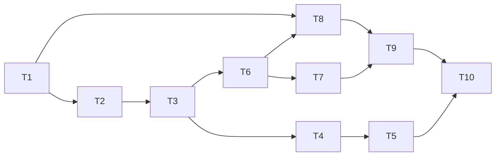

# jepa-scope Weeks 3 and 4: folder indexing, nearest-neighbour search and the latent trajectory view

- **Date:** 2026-11-06
- **Status:** Draft
- **Planned by:** planner (Fable 5.1), briefed by the lead session (Opus 5.5)
- **Spec / source:** `docs/roadmap.md`, "Next" item 1 and the project section's MVP schedule; the
  2026-11-05 process decision that milestones follow the roadmap's weekly order
- **Branch:** `week3-folder-search` (T1–T7), then `week4-trajectory` (T8–T10)

## Goal

Make jepa-scope work on a folder of clips instead of one clip. `jepa-scope <folder>` embeds every
video in the folder once (through the existing result cache), writes one index file, and opens the
viewer with a clip list, "similar moments" and "similar clips" search, and, in Week 4, a 3D view of
the open clip's path through latent space drawn through a cloud of every window in the folder.
Search is brute-force cosine over mean-pooled window embeddings, and it is checked on natural video
against a bar set in this plan before anything is measured.

Week 3 (T1–T7) delivers indexing and search end to end, from the `.latent` change to the viewer
panels, with the real-model check. Week 4 (T8–T10) delivers the trajectory view and the closeout.
The owner can stop after Week 3 and the repository is consistent.

This is one plan for both weeks because the roadmap names "Weeks 3 and 4" as one milestone and the
three deliverables share one contract: the folder index and the multi-clip server feed both the
search panels and the trajectory view, and the `.latent` change that the trajectory needs is
cheapest before the owner's folders are indexed, not after.

This plan does not build patch-level ("where in the frame") search, an approximate-nearest-neighbour
library, thumbnails in the result lists, embedding health metrics (Weeks 5 and 6), or any change to
how embeddings are computed. Everything runs on the laptop; no task needs a GPU.

## Approach

**The `.latent` file gains one tensor (T1).** `timeline_pooled`, `float32[G, D]`, is the mean over
the H×W patch features of each timeline tubelet, computed from the float32 encoder tokens before
the float16 cast that `patches` gets. It costs 4 KB per tubelet at ViT-L (about 160 KB for a
10-second clip) and is what the trajectory view plots. Because the folder indexer embeds without
patches by default (below), it is the only per-tubelet vector a folder clip keeps, so it has to be
in the file. `FORMAT_VERSION` goes to 2, and `load` and `read_header` keep refusing other versions
with their existing message. `OUTPUT_VERSION` does not change: no existing tensor changes, and the
cache file name already includes `OUTPUT_VERSION`, so a bump would leave the old file orphaned in
`~/.cache/jepa-scope` instead of replacing it. Without the bump, the cache check reads the old
file's header, gets the format-version error, prints that it is re-embedding, and writes the new
file over the same path. No embedding, energy or PCA computation changes. Doing this first means
every clip indexed in Week 3 already carries the tensor Week 4 needs.

**How windows and the timeline relate.** Each 16-frame window has a context half (its first eight
frames, four tubelets) and a predicted half. Windows overlap by half, so the timeline takes window
0 whole and, from every later window `w`, only its predicted half (`timeline_owner` in
`embed.py`); window `w`'s context half appears on the timeline as window `w - 1`'s predicted half,
encoded in a different window. Two consequences shape this plan. The mean of the timeline
tubelets a window owns is not that window's `pooled` vector, so the trajectory view does not claim
that a window's point is the centroid of its tubelets' points. And the window that owns the
tubelet at time `t` is the earlier of the two windows that contain `t`, so a search from time `t`
uses the window whose centre is nearest `t` instead.

**The index is one self-contained safetensors file (T2),** `jepa-scope.index` in the indexed folder
by default, with the same shape of contract as `.latent`: a validated JSON header under the
metadata key `jepa_scope` and a few tensors.

- Header: `format: "jepa-scope.index"`, `format_version: 1` (`INDEX_FORMAT_VERSION` in a new
  `src/jepa_scope/index_file.py`), `model_id`, `hidden_size`,
  `embedding: {"kind": "window_mean", "normalise": "centred-cosine" | "cosine"}`, the `window`
  block and `preprocess` hash copied from the clips' headers, `output_version`, `root` (the folder
  path when built, for information only: the index's own directory is authoritative), `skipped`
  (files that could not be embedded, with the reason), and `clips`, a list of `{path (relative to
  the index's directory, forward slashes), sha256, size, mtime, duration, width, height,
  cache_key (the settings digest of the clip's cached `.latent`; the path is rebuilt through
  `cache.py` from the sha256 and this key), rows: [start, stop)}`. The index holds no absolute
  paths into the cache, so it survives a moved folder or another machine's cache layout.
- Tensors: `pooled float32[N, D]` (every clip's window vectors stacked in clip order),
  `window_start_time float64[N]`, `clip int32[N]`, and `mean float32[D]` (the mean of `pooled`,
  used for centring).
- Validation checks that the row ranges tile `[0, N)` in order, that `clip[r]` agrees with the
  ranges, that `hidden_size` matches `D`, and that every clip's `latent` header agrees with the
  index's `model_id`, `window` and preprocess hash when it is opened.

For 200 ten-second clips the file is about 7 MB. Answering a search never needs the `.latent`
files; viewing a hit does.

**Search is brute force in NumPy (T3),** in `src/jepa_scope/search.py`. Vectors are centred by the
index `mean` and L2-normalised once at load; a query is one matrix–vector product and an
`argpartition`. Two query types share that primitive.

- "Moments like this moment": the query is one window, the one whose centre is nearest the current
  time. The results are windows across the folder, with the query window and any window of the
  same clip overlapping it excluded. Within one clip, a hit that overlaps a higher-ranked hit is
  dropped, so a list of ten hits is ten distinct moments. Because exclusion and suppression remove
  candidates, the search widens its candidate set (2k, 4k, and so on, then a full sort) until it
  has k hits or runs out, so lists are never short for that reason.
- "Clips like this clip": a clip's vector is the mean of its window vectors (centred and normalised
  after averaging); results are the other clips.

Centring is there because mean-pooled transformer features share a large common direction that
compresses raw cosine into a narrow band; T5 measures raw against centred on natural video and
records both. Centring on the folder's own mean breaks down for small folders: the centred clip
vectors sum to zero, so with two clips every score is −1, and with one clip the mean is the clip's
own. So the index centres only when it holds at least 10 clips, uses plain cosine below that and
in single mode, records which in `embedding.normalise`, and the viewer labels scores as relative
to this folder. A query over 30,000 windows (about 3,000 ten-second clips) is a 120 MB matrix and
about 30 ms. Brute force stops being comfortable around half a million windows (a few hundred hours
of video, 2 GB resident, about half a second per query). At that point an approximate-nearest-
neighbour library replaces the body of `search.py` behind the same function signatures, and the
index file does not change.

**The indexer (T4)** in `src/jepa_scope/indexing.py` walks the folder (not recursively by default;
`--recursive` opts in) for `.mp4 .mov .m4v .mkv .webm .avi` and skips anything under `.`-prefixed
names. For each video it finds or makes its `.latent` through the existing cache rule: it reuses a
with-patches cache file if one exists, otherwise a without-patches one, otherwise it embeds with
`keep_patches=False` (saving 4 MB per window; `--patches` keeps them).

- Refresh is incremental. A file whose size and mtime match its index entry, and whose cached
  `.latent` still exists and passes the cache check, is kept without re-hashing. Otherwise it is
  hashed: a changed hash, or a missing or invalid cache file, means re-embedding. Files that
  disappeared are dropped. A refresh cannot detect a file replaced with one of the same size and
  mtime; the server's hash check (below) does.
- An index whose `model_id`, window settings, preprocess hash or `output_version` differ from the
  current run is rebuilt from scratch with a printed reason.
- One bad file does not stop the run. A clip shorter than one window, a source below the sampling
  rate, a file with no video stream or a model output with NaN values is reported, skipped, and
  listed under `skipped` in the index header.
- Progress prints per clip. An interrupted run loses only the index file, because every embedded
  clip is already in the cache, so rerunning resumes.
- Embedding dominates the cost: about 0.35 s per second of video on an M3 Max, so an hour of video
  takes about 20 minutes.

T4's CLI gains `jepa-scope index <folder> [--out PATH] [--recursive] [--patches] <embed args>` and
`jepa-scope search <folder|index> <clip-in-index | query.mp4> [--at SECONDS] [-k 10]
[--by moment|clip]` (a query video not in the index is embedded through the cache). T6, which
makes the server able to serve a folder, also makes the default command accept a folder
(`jepa-scope <folder>` indexes, refreshing, then serves) and `jepa-scope view` accept a folder, an
index file or a `.latent`, so no merged pull request offers a command that cannot run.

**The server serves many clips (T6).** `create_app` takes an index path, a folder, or a single
`.latent`, which it wraps as a one-clip in-memory index so the viewer sees one shape in both modes.
Clip tensors load lazily on first request through an LRU of eight. Endpoints:

- `GET /api/meta` returns `{mode: "folder"|"single", index: {root, model_id, format_version,
  windows: N, embedding}, clips: [{id, name, path, duration, width, height, windows}]}`.
- `GET /api/clips/{id}/meta` returns today's per-clip `{header, timeline}` plus
  `timeline.window: int[]` and `windows.start_time: number[]`.
- `GET /api/clips/{id}/pca` and `/surprise` return bytes in the unchanged layout.
- `GET /api/clips/{id}/video` keeps the existing SHA-256 refusal. The server hashes each clip's
  video once, on its first open in that server process, and remembers the result, so a 2 GB file
  is hashed once per session rather than on every range request. Only a hash mismatch refuses: it
  returns 409 with "run `jepa-scope index` again". A file whose mtime changed but whose bytes did
  not is served normally.
- `GET /api/search?clip=&window=&k=` and `GET /api/search?clip=&k=&by=clip` return
  `{hits: [{clip, window, start_time, score}]}`.
- Week 4 adds `GET /api/clips/{id}/trajectory?fit=folder|clip`, returning `float32[G, 3]` bytes,
  and `GET /api/cloud`, returning `float32[N, 3]` bytes subsampled to at most 50,000 points, with
  the chosen rows listed in `/api/meta`.

The folder fit is a 3-component PCA (`pca.fit`, which pins signs) on the index's `pooled`.
`timeline_pooled` is projected with the same mean and components, so every clip and the cloud share
one set of axes. A window's cloud point is not the centroid of its tubelets' path points (see "How
windows and the timeline relate"); the view shows them as two related but distinct things. A
folder fit is dominated by differences between clips and may flatten motion within one clip, so
`fit=clip`, a fit on the clip's own `timeline_pooled`, is one click away, and it is the only option
in single mode. The viewer's `web/src/types.ts` changes with every one of these, in the same task
as the viewer code that uses them (T7, T9), so the viewer builds at every commit.

**The viewer (T7, T9).** `App` loads `/api/meta`, picks the clip from the URL hash (`#clip=3`) or
the first, then loads that clip's meta, bytes and video. Switching clips swaps the video source and
rebuilds the `Overlay`, which is already keyed on the data. New components:

- `ClipList.tsx`: name and duration; click to open.
- `SearchPanel.tsx`: "Similar moments" at the current tubelet and "Similar clips" for the open
  clip. A row shows the clip name, time and score, and a click opens the clip and seeks.
- Week 4 adds `Trajectory.tsx`: a Three.js scene (a pinned exact version, plus `@types/three`, and
  `OrbitControls` from the addons). The cloud is drawn as grey `Points`, and the open clip's path
  as a line through its tubelet points, coloured by mean surprise with the same inferno ramp
  (context tubelets grey). A marker on the current tubelet follows playback, search hits are drawn
  in an accent colour, hovering shows the tubelet's time, and clicking seeks the video. The fit
  toggle (folder or clip) sits on the panel.

**Shared contracts that change together in this plan:** `.latent` (`latent_file.py`, `embed.py`,
`server.py`, and now `indexing.py`); the index file (`index_file.py`, `indexing.py`, `search.py`,
`server.py`); and `/api/*` with `web/src/types.ts`. Repository invariants kept: no test media or
weights in the repo, output-changing edits bump `OUTPUT_VERSION`, the viewer ships in the wheel
(`scripts/build.sh` still checks it), no new Python dependencies (NumPy only; `uv lock --check`
stays green), and one new npm dependency (`three`).

## Alternatives considered

- **Patch-level search ("regions like this region")** — rejected for now. It needs the `patches`
  tensor for every indexed clip (4 MB per window, about 7 GB for 200 clips) and is a different
  product question. The index format leaves room for it (a later `embedding.kind`).
- **Per-tubelet search instead of per-window** — rejected for search. Tubelet features are
  contextualised by their window, adjacent tubelets are near-duplicates that would crowd every
  result list, and the window is the unit the encoder saw as one clip. Kept for the trajectory,
  where resolution matters (0.25 s per point at the defaults against 1 s per window).
- **Raw cosine, no centring** — kept as the measured comparison in T5 rather than the default, for
  the reason in Approach. If T5 shows raw is better by five points or more at top-1, the default
  flips in a one-line change and the log says so.
- **An approximate-nearest-neighbour library (FAISS, hnswlib) now** — rejected. It is a dependency
  with native wheels for a scale no user has; the plan states where brute force breaks.
- **Index only under `~/.cache/jepa-scope`** — rejected as the default. It is invisible, not
  portable with the folder, and the owner cannot tell what was indexed. `--out` covers read-only
  folders. The index is self-contained for search, so moving the folder keeps search working.
  Viewing a clip whose cache file is missing needs `jepa-scope index` (or `jepa-scope <folder>`)
  again, which re-embeds only those clips; the server never embeds.
- **A hidden index file (`.jepa-scope.index`)** — not the default, because a user should be able to
  see what the tool wrote into their folder; the indexer's rule of skipping dot-prefixed names
  would make it work. Question 3 offers it to the owner.
- **SQLite for the index** — rejected. Embeddings would be blobs, and the safetensors-plus-header
  contract already exists and is readable by any safetensors tool, which the roadmap's layer B
  wants.
- **Computing per-tubelet means at serve time from `patches`** — rejected, because folder clips have
  no patches by default.
- **The server embedding missing `.latent` files on demand** — rejected. It would put the model in
  the viewer process; `index` is the one place that embeds, and `jepa-scope <folder>` runs it
  before serving.
- **A 2D SVG projection instead of Three.js** — the cheaper option (no dependency, about a day
  less). Rejected because the roadmap names a Three.js 3D view and the folder cloud needs depth to
  stay legible. It remains the fallback if the owner declines the dependency.
- **Raw WebGL2 for the 3D view, reusing `overlay.ts`** — rejected. The overlay is a textured quad;
  orbit controls, picking and lines would be a few hundred new lines to maintain for no gain over
  Three.js.

- **Bumping `OUTPUT_VERSION` with the format change** — rejected. No existing tensor changes, and
  because the cache file name includes `OUTPUT_VERSION`, a bump would orphan old cache files
  instead of replacing them.
- **Migrating version-1 files by computing `timeline_pooled` from their `patches`** — not worth it
  today: one cache file exists, and re-embedding it takes seconds. Revisit if format changes become
  frequent.

Decision records to write in T10: the index file as a versioned contract beside the videos, with
no absolute cache paths; search as brute-force cosine over window means, centred on the folder
mean from 10 clips up; `.latent` format version 2 with `timeline_pooled` (version 1 files are
re-embedded, not migrated, and `OUTPUT_VERSION` is unchanged); and Three.js in the viewer.

## Risks and open questions

The questions for the owner are collected at the end of this plan with recommendations; the risks
here stay with the implementer.

- **Planted checks that cannot fail** — two traps found in review. With centring, a vector scaled
  by 2 does not score 1.0 against the original, so normalisation is tested on the plain-cosine
  path. And with three clips of which two are identical, the centred clip vectors force the third
  to score exactly −1, so "the grey clip ranks last" would pass whatever the encoder did. The T4
  fixture therefore has four clips, one of them a plausible alternative, and each test states
  which normalisation it uses. The tiny random V-JEPA 2 is deterministic, so a byte-identical copy
  embeds identically; a noisy near-duplicate is not used, because a one-layer random encoder gives
  no guarantee on it.
- **Search may group scenes rather than actions** — Kinetics-mini's five classes differ by static
  scene (an archery range, a bowling lane, sky, a track, a street), so a model that sees nothing
  in motion could still pass a class-retrieval bar. T5 therefore measures a model-free colour
  baseline and a single-frame V-JEPA control beside the real result, with bars set here. A bar is
  either met or escalated with the numbers; it is never lowered in the same session.
- **The index refresh can keep a stale entry** when a file is replaced with one of the same size
  and mtime. The server hashes each video on its first open and refuses a mismatch, naming the
  fix, so stale data is never shown. Documented, not otherwise solved.
- **Browser memory for the cloud** — capped at 50,000 points by subsampling in the server.
- **Three.js adds about 0.5 MB to the wheel** (tree-shaken ESM). Acceptable; the build check is
  unchanged.
- **Relative paths on Windows** — stored with forward slashes (`PurePosixPath`), joined back with
  `Path`.
- **Interrupted indexing** loses only the index file (see Approach).
- **The real-model check downloads about 100 MB** of Kinetics-mini (50 validation clips) and takes
  about five minutes on an M3 Max. It is opt-in like the existing one and never runs in CI.
- **Port 8765 and MPS** are single-instance. A second worktree passes `--port`, and only one
  session embeds at a time.

## Dependency summary

- **Week 3:** T1, T2, T3, T4, T5, T6, T7. Checkpoint after T7 with T5 recorded.
- **Week 4:** T8, T9, T10.
- **Parallel group A:** T4 and T6 (both need T3; different files).
- **Parallel group B:** T5 and T7.
- **Integration order:** T1, T2, T3, then T4 beside T6, then T5 beside T7, then T8, T9, T10.

## Task graph

### T1 — Week 3. Add `timeline_pooled` to the `.latent` file; FORMAT_VERSION 2 (the first small change)

- **Status:** Pending
- **Dependencies:** None
- **Parallel group:** Sequential
- **Complexity:** ROUTINE
- **Execution:** Lead session
- **Owner time:** 0.5 h (approve the architecture and this change; review the diff)
- **Expected files/workspaces:** `src/jepa_scope/latent_file.py`, `src/jepa_scope/embed.py`,
  `src/jepa_scope/cli.py` (the cache message), `tests/test_pipeline.py`, `README.md` (one
  sentence under the cache paragraph)
- **Objective:** In `embed_video`, keep each batch's float32 per-tubelet patch means (the tokens
  reshaped to the grid and averaged over H×W, before the float16 cast) beside `patches`, and build
  `tensors["timeline_pooled"]`, `float32[G, D]`, from them with the same `timeline_owner` mapping
  as `tl_feats`. Add `"timeline_pooled"` to `TIMELINE_KEYS` and its expected shape
  `(count, hidden_size)` to `check_tensors`. Set `FORMAT_VERSION = 2` with a comment naming this
  change; leave `OUTPUT_VERSION` alone (see Approach). Make `_cache_is_valid`'s message say that an
  older format is being re-embedded. Tests:
  - extend `test_embed_shapes`: shape `(12, 96)`, dtype float32, and for every tubelet `g`,
    `timeline_pooled[g]` within float16 rounding of `patches[w, j].reshape(-1, 96).mean(0)` with
    `(w, j) = timeline_owner(g, half)`;
  - add a `timeline_pooled` row-count case to `test_load_rejects_other_inconsistencies`;
  - add a test that a file whose header says `format_version: 1` is refused by `read_header` and
    `load`. It writes the safetensors metadata directly, because `latent_file.save` overwrites
    `format_version`;
  - add a test that `_cache_is_valid` returns False for that file and prints the message.
- **Success criteria:**
  - `uv run pytest -q` passes; the new assertions fail if the tensor is dropped, mis-shaped or
    taken from the wrong window (checked once by breaking each, noted in the log).
  - `jepa-scope clip.mp4` on the existing version-1 cache file prints the re-embedding message,
    re-embeds, and leaves one file in `~/.cache/jepa-scope`, not two.
- **Verification:** `uv run pytest -q tests/test_pipeline.py`; `uv run ruff check src tests`;
  `uv run jepa-scope <local clip> --no-browser` once; `ls ~/.cache/jepa-scope`.
- **Escalate if:** the owner prefers no format change (then the trajectory view would need patches
  for every indexed clip; re-plan T4 and T8).

### T2 — Week 3. The index file contract

- **Status:** Pending
- **Dependencies:** T1
- **Parallel group:** Sequential
- **Complexity:** ROUTINE
- **Execution:** Executor
- **Owner time:** None
- **Expected files/workspaces:** `src/jepa_scope/index_file.py` (new), `tests/test_index.py` (new)
- **Objective:** Implement `INDEX_FORMAT = "jepa-scope.index"`, `INDEX_FORMAT_VERSION = 1`,
  `IndexFileError`, `save(path, tensors, header)` (a temporary name then `os.replace`, like
  `latent_file.save`), `read_header`, `load`, and `check(tensors, header)` with the validation
  listed in Approach. Provide a small typed view, `Index` (a dataclass holding the header,
  `pooled`, `window_start_time`, `clip`, `mean`, and helpers `clip_rows(i) -> slice` and
  `clip_vector(i)`), so `search.py` and `server.py` share one object. Tests: a round trip on
  synthetic arrays; rejection of overlapping or gapped `rows`, of `clip` disagreeing with `rows`,
  of a wrong `hidden_size`, and of a plain safetensors file.
- **Success criteria:** tests pass, and each rejection test fails if its check is removed.
- **Verification:** `uv run pytest -q tests/test_index.py`; ruff.
- **Escalate if:** the header needs a field this plan did not list that changes what the viewer
  shows.

### T3 — Week 3. Search with planted checks

- **Status:** Pending
- **Dependencies:** T2
- **Parallel group:** Sequential
- **Complexity:** ROUTINE
- **Execution:** Executor
- **Owner time:** None
- **Expected files/workspaces:** `src/jepa_scope/search.py` (new), `tests/test_index.py`
- **Objective:** `prepare(index, centre) -> SearchSpace` (the normalised matrix, centred or not,
  kept on the `Index`; `centre` defaults to the rule in Approach, at least 10 clips),
  `window_at(space, clip, t)` (the window whose centre is nearest `t`),
  `nearest_moments(space, clip, window, k)` and `nearest_clips(space, clip, k)` with the exclusion,
  suppression and widening rules in Approach, plus `query_vector(space, pooled_rows)` for an
  external query video (T4's `search` command). Tests on a synthetic index, each stating whether
  it runs centred or not:
  - an exact duplicate row scores 1.0 and ranks first (both paths);
  - a row scaled by 2 scores 1.0 against the original (plain-cosine path only, where it must hold);
  - the query window and its overlapping neighbours in the same clip never appear;
  - two overlapping hits in one clip collapse to the better one;
  - a folder where suppression removes most candidates still returns k hits when k exist;
  - with a large common offset added to every vector plus a planted structure, centred search
    recovers the structure and plain search does not (the centring test has teeth);
  - folders of 9 and 10 clips choose plain and centred cosine respectively;
  - `window_at` picks the later window for a time in the second half of an overlap;
  - `nearest_clips` excludes the query clip.
- **Success criteria:** every test fails when its rule is removed (checked once by hand, noted in
  the log).
- **Verification:** `uv run pytest -q tests/test_index.py`.
- **Escalate if:** the suppression rule makes result lists empty on realistic folders (report with
  numbers).

### T4 — Week 3. The indexer and the CLI

- **Status:** Pending
- **Dependencies:** T3
- **Parallel group:** A (with T6)
- **Complexity:** STRONG
- **Execution:** Lead session or an Opus executor
- **Owner time:** 0.5 h (review the diff and try `jepa-scope index` on one of their folders)
- **Expected files/workspaces:** `src/jepa_scope/indexing.py` (new), `src/jepa_scope/cache.py`
  (new), `src/jepa_scope/cli.py`, `tests/test_index.py`, `README.md`
- **Objective:** `build_or_refresh(folder, encoder_factory, settings, out, recursive, patches, log)`
  as in Approach. The cache lookup reuses `cli._cache_path`; move it and `_cache_is_valid` into a
  small `cache.py` so `indexing.py` does not import the CLI. The encoder is created lazily, only
  when a clip must be embedded, so a refresh with nothing new never loads the model. T4 adds the
  `index` and `search` commands only; the default command and `view` learn about folders in T6.
  Tests use `tiny_encoder` on a tmp folder of five videos: the moving square, an exact copy under
  another name, the square moving right to left (a plausible alternative), a constant-grey clip,
  and a one-second clip shorter than a window:
  - the index has four clips with 5 windows each, and the one-second clip is listed under
    `skipped` with its reason;
  - a second run embeds nothing (count calls through a wrapper);
  - touching one file's mtime without changing bytes re-hashes but does not re-embed;
  - rewriting one file re-embeds only it; deleting one drops it;
  - deleting one clip's cache file makes the next refresh re-embed only that clip;
  - a settings change rebuilds everything;
  - with plain cosine (four clips is below the centring threshold), `nearest_clips` from the moving
    square ranks its copy first with a score within 1e-6 of 1.0, and the reversed square's score
    lies strictly between the copy's and the grey clip's;
  - `nearest_moments` from any window of the square finds the copy's matching window with a score
    within 1e-6 of 1.0.
- **Success criteria:** the tests above; `jepa-scope index <folder>` on a real folder prints
  progress and writes `jepa-scope.index`, and a second run finishes in under two seconds with no
  model load; `jepa-scope search <folder> <clip> --at 3` prints a ranked table.
- **Verification:** `uv run pytest -q`; `uv run jepa-scope index <a local folder>` twice; ruff.
- **Escalate if:** cache reuse needs the cache key to change (an `OUTPUT_VERSION` question for the
  owner); the tiny encoder's duplicate does not score 1.0 (non-determinism in the pipeline, which
  would be a finding in itself); or the reversed square does not land between the copy and the
  grey clip (the tiny encoder is seeded, so the outcome is fixed; report it with the scores rather
  than drop the assertion).

### T5 — Week 3. The real-model retrieval check, with its bar set here

- **Status:** Pending
- **Dependencies:** T4
- **Parallel group:** B (with T7)
- **Complexity:** STRONG (the bar is set in this plan; the implementation is routine)
- **Execution:** Lead session (runs locally with the weights)
- **Owner time:** 0.3 h (read the numbers)
- **Expected files/workspaces:** `tests/test_real_model.py`, the plan's log, `README.md` (the
  measured numbers, as an anecdote rather than a benchmark, as the surprise section does)
- **Objective:** Add `test_search_groups_kinetics_classes`, opt-in under the same environment
  variable. Download the 50 `val/` clips of `nateraw/kinetics-mini` (five classes: archery,
  bowling, flying_kite, high_jump and marching, ten clips each, about 10 s each) with
  `snapshot_download(allow_patterns="val/*")` (about 95 MB) into a tmp folder, build the index
  with the indexer at the defaults (8 fps, 16-frame windows, no patches, about 450 windows), and
  measure, leaving one clip out at a time:
  - (a) the clip-level top-1 same-class rate over the 50 clips (chance 9/49 = 18.4%);
  - (b) the window-level top-1 same-class rate over all windows, excluding the query's own clip;
  - (c) both of these with plain cosine as well as centred (50 clips is above the threshold, so
    centred is the default here);
  - (d) a model-free baseline: the clip-level rate when each clip is represented by the
    colour histogram of its middle frame (8 bins per RGB channel, cosine), which takes seconds;
  - (e) a single-frame V-JEPA control: each clip's middle frame repeated 16 times, written as a
    clip and indexed through the same code (50 extra windows, about three minutes), with its
    clip-level rate.

  Print everything, and log each clip's resolution and bitrate beside its top hit so that
  clustering by resolution can be checked afterwards rather than guessed. **Bars, fixed now:** the
  test passes only if the centred clip-level top-1 rate is at least 0.60 **and** at least 0.15
  above the colour baseline (d). Miss either and the task escalates with the numbers; the bars are
  not moved in the same session. The single-frame control (e) is not a pass condition, because the
  five classes differ by scene and a single frame may retrieve well; its comparison with the full
  windows is recorded in the README either way, as the evidence on whether search reflects motion
  or mostly scene. If plain cosine beats centred by five points or more at clip level, the default
  flips (one line, logged); otherwise centred stays. The fast tests already check that a query
  never retrieves its own clip, so no permutation control is needed for that.
- **Success criteria:** the test passes at the bars above; the log records every number, the
  download size and the run time.
- **Verification:** `JEPA_SCOPE_MODEL_TESTS=1 uv run pytest tests/test_real_model.py -s -k search`.
- **Escalate if:** either bar is missed. The options are then a different vector, chosen by the
  owner: pooling only the predicted half of each window, only the context half, or the hidden
  state before the encoder's final layer norm. (Re-normalising the tokens is not an option: the
  encoder's output is already layer-normalised.) The fast checks stay as they are.

### T6 — Week 3. The server serves a folder

- **Status:** Pending
- **Dependencies:** T3
- **Parallel group:** A (with T4)
- **Complexity:** STRONG
- **Execution:** Lead session or an Opus executor
- **Owner time:** None
- **Expected files/workspaces:** `src/jepa_scope/server.py`, `src/jepa_scope/cli.py` (`_serve`,
  the default command and `view` accepting a folder or an index), `tests/test_pipeline.py`,
  `tests/test_index.py`. The API is documented in `server.py`'s module docstring; `types.ts`
  changes in T7 with the code that uses it, so the viewer builds at every commit.
- **Objective:** Endpoints and behaviour as in Approach, without the Week 4 ones. Keep
  `create_app(latent_path, video_path, video_sha256)` working by wrapping the file as a one-clip
  index. Update `test_server_endpoints` to the new paths and add a folder-mode test on the T4
  fixture: `/api/meta` lists four clips; `/api/clips/1/pca` has the right length;
  `/api/clips/2/video` serves ranges; `/api/search?clip=0&window=2&k=3` returns the copy's
  matching window first; a clip whose video bytes were replaced (same size, mtime restored)
  returns 409 with the index message; and a clip whose mtime alone changed is served.
- **Success criteria:** both modes pass. `uv run jepa-scope view x.latent --no-browser` serves the
  data at the new paths; the built viewer reads them once T7 lands (until then the old viewer
  shows an error; T6 and T7 ship in one pull request, so no merged state has that error).
- **Verification:** `uv run pytest -q`; `curl -s localhost:8765/api/meta | head -c 400`.
- **Escalate if:** lazy loading needs more than an LRU (for example, memory pressure from
  patches-bearing cache files; the fix would be loading only the timeline tensors with
  `safe_open`, which is a small change but worth a note).

### T7 — Week 3. Viewer: clip list and search panels

- **Status:** Pending
- **Dependencies:** T6
- **Parallel group:** B (with T5)
- **Complexity:** STRONG
- **Execution:** Lead session (the lead has a browser for live checks)
- **Owner time:** 1 h (review; a live check on one of their folders; the Week 3 checkpoint)
- **Expected files/workspaces:** `web/src/App.tsx`, `web/src/ClipList.tsx` (new),
  `web/src/SearchPanel.tsx` (new), `web/src/types.ts`, `web/src/index.css`, `README.md`
- **Objective:** As in Approach. Clip switching keeps the mode, opacity and smoothing; the URL hash
  tracks the clip so reloads keep it; search rows open and seek; keyboard shortcuts are unchanged.
  The search panel shows the query's time span and labels scores as relative to this folder.
  Single mode hides the clip list and shows "similar moments" within the clip. The lead checks it
  in a browser on a small folder (the T4 fixture written to a temp folder, then a real folder of
  the owner's clips) and records what was seen in the log.
- **Success criteria:** `npx tsc -b`, `npx oxlint --type-aware src` and `npm run build` pass;
  `./scripts/build.sh` passes; in the browser, opening a moment from a search result shows that
  clip with the overlay at that time; the Week 3 checkpoint runs (`/checkpoint`) and a fresh
  `reviewer` pass on T1–T7 finds no material issue.
- **Verification:** the three web commands; `./scripts/build.sh`; the lead's browser check with
  notes in the log.
- **Escalate if:** the overlay cannot be rebuilt on clip switch without a WebGL context leak (then
  the `Overlay` gains a `dispose`, which is a small change but outside this task's files).

### T8 — Week 4. Trajectory and cloud endpoints

- **Status:** Pending
- **Dependencies:** T1, T6
- **Parallel group:** Sequential
- **Complexity:** ROUTINE
- **Execution:** Executor
- **Owner time:** None
- **Expected files/workspaces:** `src/jepa_scope/server.py` (and its API docstring),
  `src/jepa_scope/pca.py` (a `project` helper if `to_rgb`'s scaling is not wanted; keep `fit`),
  `tests/test_pipeline.py`
- **Objective:** `GET /api/clips/{id}/trajectory?fit=folder|clip` and `GET /api/cloud` as in
  Approach, with the 50,000-point cap and the chosen rows in `/api/meta`. Tests: the trajectory has
  `count` rows of 3 floats; with `fit=folder`, the server's trajectory and cloud bytes equal
  `timeline_pooled` and `pooled` projected with one `(mean, components)` computed independently in
  the test from the index (the shared-axes property); `fit=clip` gives different axes from
  `fit=folder`; `fit=clip` works in single mode; `fit=folder` in single mode returns 400.
- **Success criteria:** tests pass; the shared-axes test fails when the cloud is projected with a
  per-clip fit (checked once).
- **Verification:** `uv run pytest -q`.
- **Escalate if:** none expected.

### T9 — Week 4. The Three.js trajectory view

- **Status:** Pending
- **Dependencies:** T7, T8
- **Parallel group:** Sequential
- **Complexity:** STRONG
- **Execution:** Lead session
- **Owner time:** 1 h (approve the dependency if not already decided; review; live check)
- **Expected files/workspaces:** `web/package.json`, `web/package-lock.json`,
  `web/src/Trajectory.tsx` (new), `web/src/App.tsx`, `web/src/types.ts`, `web/src/index.css`,
  `tests/test_real_model.py` (the separation ratio), `README.md`
- **Objective:** As in Approach. Add `three` and `@types/three` pinned to exact versions current at
  execution time. The marker follows the current tubelet; hovering a path point shows its time;
  clicking seeks; search hits from the open result list are highlighted in the cloud; the fit
  toggle refetches the trajectory. Dispose the renderer and geometry on unmount and on clip switch.
  Check it on the archery-onto-bowling cut clip the existing real-model test builds, and on a
  folder. The shape check is numeric, on the 3D points, with the bar fixed now: the separation
  ratio (the distance between the centroids of the pre-cut and post-cut tubelets divided by the
  mean distance of tubelets to their own segment's centroid) is at least 3 on the cut clip and
  below 3 on an uncut 10-second Kinetics clip split at its midpoint, both with `fit=clip` in single
  mode. The ratio is printed by an opt-in test in `tests/test_real_model.py`; the visual check is
  for the view, not the evidence.
- **Success criteria:** the three web commands and `./scripts/build.sh` pass; the wheel grows by
  less than 1 MB; the separation ratios meet the bars above; the marker tracks playback without
  visible lag; a fresh `reviewer` pass on T8–T9.
- **Verification:** `cd web && npx tsc -b && npx oxlint --type-aware src && npm run build`;
  `./scripts/build.sh`; the lead's browser check with notes.
- **Escalate if:** either separation bar is missed. That is a finding about the embedding, not the
  view; report it with the numbers rather than adjust the view or the bar.

### T10 — Week 4. Documentation, decisions and closeout

- **Status:** Pending
- **Dependencies:** T5, T9
- **Parallel group:** Sequential
- **Complexity:** ROUTINE
- **Execution:** Lead session
- **Owner time:** 0.5 h (review; merge)
- **Expected files/workspaces:** `README.md`, `docs/roadmap.md` (progress table, "Next"),
  `docs/decisions.md`, `docs/decisions/product.md`, `docs/decisions/method.md`, `CLAUDE.md` (the
  layout list gains `index_file.py`, `indexing.py`, `search.py` and the index contract, staying
  under 14 KB), `docs/plans/README.md`, this plan's status and completion summary
- **Objective:** Write the four decision lines from Alternatives considered with their detail
  entries; document the CLI, the index file and the trajectory view for outside readers; record
  the T5 numbers; compress the log into the completion summary with its lesson or `NO_ENTRY`; run
  `python3 .claude/workflow/check.py`.
- **Success criteria:** the workflow check passes; the roadmap's "Next" names Weeks 5 and 6; the
  plan is `Done` and off the active list.
- **Verification:** `python3 .claude/workflow/check.py`; `rg -n 'jepa-scope.index' README.md docs`.
- **Escalate if:** none expected.

## Execution strategy

- **Lead/orchestrator owns:** the architecture, every shared-contract edit (T1, the API in T6, and
  `types.ts` in T7 and T9), the viewer work (T7, T9), the real-model runs (T5, T9), integration,
  and every exchange with the owner.
- **Delegated tasks:** T2, T3 and T8 to `executor` (ROUTINE, self-contained, tests included); T4
  and T6 to an Opus `executor` if the lead wants them concurrent, otherwise the lead does them in
  order.
- **Model routing:** T1 ROUTINE (lead); T2, T3, T8 and T10 ROUTINE; T4, T6, T7 and T9 STRONG; T5
  STRONG with its bar fixed here by the planner. Every review runs on `reviewer` at its default.
- **Owner time, total:** about 4 hours over the two weeks: the approval gate (0.5), T4 (0.5), T5
  (0.3), T7 (1), T9 (1), T10 and merges (0.5), plus the questions below (0.3).
- **Compute:** laptop only. The heaviest step is T5 (about eight minutes of embedding on an M3 Max,
  including the single-frame control, and a 95 MB download). No GPU, no spend.
- **Approval gates:**
  - Owner approval of this plan's questions and of T1 as the first small change before any code
    file is edited.
  - Owner approval before dispatching code-writing executors (the task graph and routing above).
  - Owner approval of the Three.js dependency before T9 (question 6), and of the raw-versus-centred
    flip if T5 triggers it.
  - The Week 3 checkpoint after T7: the owner decides whether Week 4 starts.
- **Owner-only actions:** merging each pull request. Proposed grouping: PR 1 = T1; PR 2 = T2–T5;
  PR 3 = T6–T7; PR 4 = T8–T10. The owner may fold PR 1 into PR 2 for fewer merges. No release, no
  repository setting and no public post is in this plan; the launch demo is Weeks 5 and 6.
- **Review strategy:** `reviewer` with fresh context at the end of Week 3 (T1–T7, the plan and the
  diff, with T5's numbers) and at the end of Week 4 (T8–T10). Two strikes on any failing check go
  to `reviewer` or `architect` before a third attempt. `/checkpoint` after each integrated task.

### Concurrency and isolation

| Task | Actually concurrent with | Worker/session | Writes files? | Branch/base | Isolation | Shared mutable resources | Integration |
|---|---|---|---:|---|---|---|---|
| T1 | None | Lead | Yes | `week3-folder-search` from `main` | Main checkout | Result cache (re-embeds one file) | Direct |
| T2 | None | Executor | Yes | same branch | Main checkout | None | Direct |
| T3 | None | Executor | Yes | same branch | Main checkout | None | Direct |
| T4 | T6 (optional) | Lead or Opus executor | Yes | same branch | Worktree if concurrent | Result cache, MPS (embeds) | Cherry-pick |
| T5 | T7 (optional) | Lead | Tests only | same branch | Main checkout | Hugging Face cache, result cache, MPS | Direct |
| T6 | T4 (optional) | Lead or Opus executor | Yes | same branch | Worktree if concurrent, `--port 8766` | Port 8765 | Cherry-pick |
| T7 | T5 (optional) | Lead | Yes | same branch | Main checkout | Port 8765 | Direct |
| T8 | None | Executor | Yes | `week4-trajectory` from `main` after PR 3 | Main checkout | None | Direct |
| T9 | None | Lead | Yes | same branch | Main checkout | Port 8765 | Direct |
| T10 | None | Lead | Yes | same branch | Main checkout | None | Direct |

Default timing is sequential throughout. The two optional overlaps are worth taking only when two
workers are idle; then they load the `parallel-work` skill, use a worktree each (`uv sync`,
`cd web && npm ci && npm run build`), stage explicit paths, and never embed at the same time as
another session (MPS is single-instance).

## Execution log

Kept in `docs/plans/2026-11-06-weeks3-4-folder-search-trajectory-log.md` in the template's format.

## Integration and verification

### Integrated checkpoint
- [ ] `/checkpoint` after T7 (Week 3) and after T9 (Week 4)

### End-to-end acceptance
- [ ] `jepa-scope <folder>` on a folder of the owner's clips indexes once, reopens instantly, and a
  "similar moments" click lands on a plausible moment in another clip
- [ ] `jepa-scope clip.mp4` (single mode) still works, including the SHA-256 refusal
- [ ] The real-model retrieval check passes at its bars and its numbers are in the README and the
  log
- [ ] The separation ratio is at least 3 on the cut clip and below 3 on the uncut clip
- [ ] A replaced video is refused with the "run index again" message

### Plan review
- **Reviewers:** a fresh Fable agent, then ChatGPT Astra on the revised plan, adversarially,
  before the owner approves.
- **Round 1 (Fable, 2026-11-06): sound with changes.** Two critical findings, both confirmed in
  the code and fixed in this revision. The planned "centroid property" test was false, because
  every window after the first owns only its predicted half of the timeline, and the timeline
  features are float16 while the window vectors are float32. Two planted search checks could not
  fail: a scaled vector does not score 1.0 once centred, and with three clips of which two are
  identical, centring forces the third to score −1. Six major findings were also fixed:
  - the server, not the index refresh, now owns the hash check;
  - `OUTPUT_VERSION` is no longer bumped, since a bump would orphan cache files;
  - the index stores cache keys rather than absolute paths, and the refresh re-embeds when a
    cache file is missing;
  - the folder commands move to T6 so no merged pull request offers a command that cannot run;
  - T5 gains a colour baseline and a single-frame control, because Kinetics-mini's classes differ
    by scene;
  - the T5 fallback options no longer include re-normalising tokens that are already normalised.

  The minor findings changed the centring rule for small folders, the query window, result-list
  widening, per-clip failure handling, a numeric trajectory check, where the API types land and
  the format-version test.
- **Round 2 (Astra):** pending.

### Independent review
- **Reviewer:** `reviewer` (Opus, high), at the end of each week as above
- **Verdict:** Pending

## Questions for the owner, with recommendations

1. **One plan or two?** One plan, with Week 3 = T1–T7 and a stop point after T7. The index and the
   multi-clip server are shared by search and the trajectory, and the `.latent` change is cheapest
   before your folders are indexed.
2. **Search unit, embedding, distance, query types.** Windows for "moments like this moment" and the
   mean of windows for "clips like this clip", both over mean-pooled window vectors, with cosine
   after subtracting the folder mean when the folder has at least 10 clips, and plain cosine below
   that (plain cosine is measured beside centred in T5). Not patches, not tubelets.
3. **Where the index lives and whether it is a contract.** One self-contained `jepa-scope.index`
   safetensors file in the folder (`--out` for read-only folders), versioned by
   `INDEX_FORMAT_VERSION`, refreshed by size-and-mtime then SHA-256, rebuilt when settings change,
   with a decision record. The cache directory stays for `.latent` files only. The alternative is
   a hidden `.jepa-scope.index`, which keeps synced or versioned folders tidier but hides what the
   tool wrote; the recommendation is the visible file.
4. **Brute force or an approximate-nearest-neighbour library.** NumPy brute force. It is
   comfortable to about half a million windows (a few hundred hours of video), and a library can
   replace `search.py`'s body later without changing the file.
5. **The `.latent` format change first.** Add `timeline_pooled` now as T1 (FORMAT_VERSION 2;
   OUTPUT_VERSION unchanged). It re-embeds your current cache (one 36 MB file today, replaced in
   place) and means Week 3's indexing already stores what Week 4 plots. The alternative is to defer
   it to Week 4 and re-embed every indexed folder then.
6. **Trajectory view: Three.js or no new dependency.** Three.js (pinned, about 0.5 MB in the wheel)
   for a 3D path with the folder cloud, PCA fitted on the folder by default with a per-clip toggle,
   per-tubelet points coloured by surprise, hover for the time and click to seek. The fallback is a
   2D SVG projection with no dependency, about a day cheaper and less legible with the cloud.
7. **CLI shape.** `jepa-scope <folder>` (index, then view), `jepa-scope index <folder>`,
   `jepa-scope search <folder|index> <clip|query.mp4> [--at S] [-k] [--by moment|clip]`, and
   `jepa-scope view` accepting a folder, an index or a `.latent`. The indexer embeds without
   patches by default (`--patches` keeps them) and reuses any cache file that already exists.
8. **The real-model bar.** On Kinetics-mini's 50 validation clips (5 classes × 10), the
   leave-one-clip-out clip-level top-1 same-class rate is at least 0.60 (chance 0.18) and at least
   0.15 above a model-free colour-histogram baseline. A single-frame V-JEPA control is measured and
   reported but is not a pass condition, since these classes differ by scene. A miss escalates
   with the numbers, and the bar is not lowered in the same session.
9. **Pull-request grouping.** Four PRs (T1; T2–T5, which adds the `index` and `search` commands;
   T6–T7, which adds folder viewing; T8–T10), each merged by you; fold T1 into the second if you
   prefer three.

## Completion summary

To be written at closeout.
